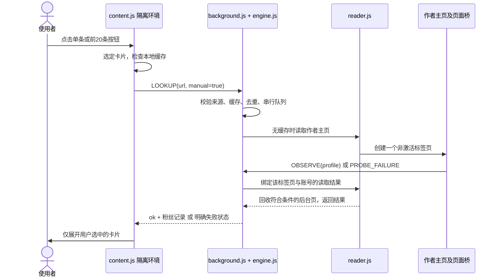

# 小红书粉丝助手：跨环境一比一复刻文档

作者：马哥。参考实现：0.3.1。文档核对日期：2026-10-17。

这份文档可直接交给 Codex、Claude Code、Cursor、OpenCode 或其他能读写本地文件、运行终端命令的 AI Agent。它包含明确的行为规则、实现协议、全部运行源码、图标、开发依赖锁文件、打包程序和48项测试。只拿到这一份 Markdown 文件，也能在自己的电脑还原项目，不需要访问原作者的电脑、历史聊天、私有知识库或登录资料。

这里的“一比一”指按本文件附录还原0.3.1源码和交互，使用文件哈希及测试核对。Windows、macOS、Linux采用同一套扩展代码；本文给出各系统步骤，但没有把某一台Windows电脑的实测说成三套系统都已实测。网站后续改版、使用者登录状态和平台限流会影响读取效果，不属于源码复制能保证的范围。

## 1. 直接复制给自己的AI

```text
请完整阅读《小红书粉丝助手：跨环境一比一复刻文档》，在当前工作区还原其中0.3.1参考实现。

先检查操作系统、Chrome、Node.js和Python。优先从本文“可机器提取的完整文件附录”逐文件恢复，不要重新猜测实现，不要只写演示页面，不要用固定粉丝数字冒充成功。图标使用附录提供的Base64文件。

保留手动逐条查看和“查看当前前20条粉丝数”。没有用户点击时不得发起主页查询，也不得自动展开有缓存的其他作者卡片。取消插件自身的小时和每日次数额度；保留串行、至少3秒间隔、30分钟缓存、去重、停止和网站验证暂停。

还原后核对SOURCE-MANIFEST.json，安装开发依赖，运行全部48项测试、7个运行JS语法检查和打包检查。给我包含manifest.json的extension文件夹与安装ZIP。

用我自己的Chrome资料和我自己的小红书登录状态安装。若你有现成浏览器连接就操作；没有则给我准确的手动安装步骤。不要复制他人的浏览器资料、Cookie、绝对路径或扩展ID；不要为了连接Chrome关闭我的所有浏览器，也不要自动处理验证码。

最后在我的实际浏览器检查默认不查询、点击一位作者、前20条、20条外仍可单查、停止和缓存。将自动测试、真实浏览器测试、未验证事项分别报告。只能将真正完成的项目标成完成。
```

任务不依赖某个AI品牌、付费模型、特定Skill、MCP或云服务器。AI没有电脑控制工具时，仍须先完成文件还原、测试和打包，再指导用户加载扩展；不得把“文件已生成”写成“已经安装进Chrome”。

## 2. 插件最终应当是什么样

打开小红书网页版，搜索关键词；需要按点赞排序时，由用户在网站上先排好序。作者昵称旁默认出现“点击查看粉丝数”，页面右下角出现“查看当前前20条粉丝数”。

点击某个作者，只展开这张卡片的粉丝数；点击右下角批量按钮，按当前已加载笔记列表顺序处理前20条。其余卡片继续保留单独查看按钮。用户浏览、滚动、进入页面、出现新卡片和缓存更新，都不能自动发起作者主页查询。

| 项目 | 0.3.1固定要求 |
| --- | --- |
| 扩展名称 / 版本 | 马哥小红书粉丝助手 / 0.3.1 |
| 目标站点 | `https://www.xiaohongshu.com/*` |
| 运行结构 | Chrome Manifest V3，无运行时第三方依赖 |
| 单条入口 | 作者昵称旁“点击查看粉丝数” |
| 页面入口 | 右下角“查看当前前20条粉丝数” |
| 批量范围 | 点击时当前列表前20条笔记，不是20位去重后的作者，不是当前屏幕可见区20条 |
| 排序 / 翻页 | 用户自行排序；插件不自动排序、不滚动补齐、不翻页 |
| 次数额度 | 不设每小时或每日次数上限，不显示旧额度提示 |
| 读取方式 | 缺缓存时串行打开后台作者主页，由网站自己的页面正常加载数据 |
| 读取速度 | 同一后台引擎两次读取开始至少间隔3000毫秒 |
| 缓存 | 30分钟、最多500位作者；跨卡片复用，未选择卡片不展开数字 |
| 队列 | 同作者合并在途请求；待处理作者最多16位，队列满可稍后手动重试 |
| 单次超时 | 后台主页读取15秒超时；用户激活过的页必须保留 |
| 失败暂停 | 登录、验证、访问限制立即暂停；其他连续失败3次暂停 |
| 弹窗 | 显示查看按钮开关、有效缓存数、不设次数上限、恢复查询及清缓存 |
| 旧数据迁移 | `automatic`强制为false；忽略并移除旧`budget`字段 |

一次批量按前20条“笔记”取目标。同作者重复笔记可以少发请求；前20条里没有合法作者链接的笔记不以第21条补位；列表不足20条就只处理已有条目。遇到`display:none`、`visibility:hidden`、`hidden`或`aria-hidden=true`的笔记不参与排名；仅在屏幕下方但已加载的卡片仍参与。

“次数不限”只表示插件没有次数计数器。并发限制、3秒间隔、500条缓存容量、15秒超时和网站验证暂停仍然存在，不能擅自一起删除。

## 3. 环境与目录

| 需要做什么 | 环境要求 |
| --- | --- |
| 只安装使用 | 桌面Chrome，manifest最低版本111；使用自己的小红书登录状态 |
| 跑自动测试 | Node.js 22或更新版本、npm、首次安装依赖时能访问npm镜像或已有完整缓存 |
| 从文档恢复 / 打包 | Python 3.9或更新版本，仅使用标准库 |
| GitHub下载 | 可以下载仓库ZIP；Git不是运行插件的依赖 |
| 实站自动调试 | 可选浏览器控制连接；没有MCP也能手动安装和验证 |

本项目不需要API Key、后台服务、数据库、Docker、云主机、远程脚本、Playwright浏览器下载或复制他人Chrome资料。不要让用户为了运行扩展安装开发依赖；已有`extension`目录可直接加载。

```text
mage-xhs-fans/
  extension/
    manifest.json
    core.js
    engine.js
    reader.js
    background.js
    page-bridge.js
    content.js
    content.css
    popup.html
    popup.js
    popup.css
    icons/icon16.png
    icons/icon32.png
    icons/icon48.png
    icons/icon128.png
  tests/                        # 7个*.test.cjs文件，共48项测试
  scripts/package.py            # 确定性文件清单、图标生成及ZIP打包
  scripts/restore_from_doc.py    # 本文文件附录提取器
  package.json
  package-lock.json
  SOURCE-MANIFEST.json          # 相对路径、字节数、SHA256
  README.md
  AGENTS.md
  给AI的复刻指令.md
  安装说明.md
  隐私说明.md
  更新说明-0.3.1.md
  dist/                         # 运行打包程序后生成
```

所有路径相对项目根目录计算。示例`<项目目录>`由接收者选择，不能照搬原作者机器的盘符、用户名、Profile目录或扩展ID。每台电脑的扩展ID和个人资料名称可能不同，不属于复刻失败。

## 4. 两种还原方式

### 4.1 已有仓库源码包

下载`mage-xhs-fans-0.3.1-source.zip`并完整解压到一个长期保留的目录，进入含`package.json`和`extension`的那层。按第10节运行验证。

### 4.2 只有这一份Markdown

让AI读取末尾所有`MAGE_REPLICA_FILE`文件块，按相对路径写出文件。文本块按记录的换行格式恢复UTF-8，PNG块按Base64解码，然后逐文件校验SHA256。不能漏掉`package-lock.json`、测试或图标。

仓库另提供`restore_from_doc.py`，与附录内的`scripts/restore_from_doc.py`相同。若只有本文，先让AI将该脚本块保存为`restore_from_doc.py`，再执行：

```powershell
# Windows PowerShell；路径包含空格时必须保留引号
py -3 restore_from_doc.py --document '小红书粉丝助手-跨环境一比一复刻文档.md' --output 'D:\Projects\mage-xhs-fans'
```

```bash
# macOS / Linux
python3 restore_from_doc.py --document '小红书粉丝助手-跨环境一比一复刻文档.md' --output "$HOME/Projects/mage-xhs-fans"
```

提取器要求目标目录不存在或为空；先完整校验所有文件，再写入，不覆盖已有工程。校验失败时重新下载原始Markdown，不能跳过SHA256直接宣称复刻成功。应下载文档原始文件，而不是把GitHub页面HTML另存为`.md`。

## 5. 运行架构与关键实现



### 5.1 manifest与执行环境

`permissions`仅含`storage`；`host_permissions`仅含`https://www.xiaohongshu.com/*`。不追加`cookies`、`history`、`debugger`、`<all_urls>`或远程代码权限。

`background.service_worker`指向`background.js`，通过`importScripts`加载`core.js`、`engine.js`和`reader.js`。`action.default_popup`是`popup.html`。

同一站点配置两组内容脚本：

| 时间 / world | 文件 | 用途 |
| --- | --- | --- |
| document_start / MAIN | core.js、page-bridge.js | 观察网站本来就加载的主页状态和正常响应 |
| document_idle / ISOLATED | core.js、content.js、content.css | 页面按钮、隔离环境扩展消息和状态展示 |

MAIN环境中的网页桥不调用`chrome.runtime`，扩展API由隔离环境和service worker使用。执行顺序与world不可合并或随意调换。Chrome官方对内容脚本的加载顺序、运行时机与world有说明：[内容脚本清单](https://developer.chrome.com/docs/extensions/reference/manifest/content-scripts)。

### 5.2 core.js：只接受真实粉丝统计

保留这些接口：`validId`、`profileUrl`、`normalizeCount`、`fromProfile`、`fromState`、`fromResponse`、`cleanProfile`和`freshRecord`。浏览器导出`globalThis.XhsFans`；Node测试导出CommonJS对象。

- 账号ID只接受24位十六进制，规范化小写。
- 作者地址只接受HTTPS本站`/user/profile/<id>`路径，拒绝外域、伪造子域、用户密码段和多余路径。
- 已有`xsec_token`、`xsec_source`仅按长度规则保留在本次读取URL，不生成它们，不写入缓存。
- 优先读取`interactions`或`interacts`中`type==='fans'`的条目；只有没有type且name为“粉丝”时才允许名称匹配。
- 支持`user.userPageData`，以及有限层数的Vue ref包装`value`、`_value`、`_rawValue`。
- 响应绑定正常`otherinfo`请求的`target_user_id`；若数据中的userId冲突，拒绝该结果。
- 接受非负安全整数、`12,345`、`1.2万`、`2亿+`和w/k/m等平台文字；有单位或加号标记`approximate=true`并保留原显示含义。
- 缺失、非法、负数、NaN、关注数或获赞数都不能变成粉丝0。只有明确读到0才显示0。

统一记录结构：

```json
{"id":"000000000000000000000001","value":12000,"text":"1.2万","approximate":true,"at":10000000}
```

`at`由插件读取时间生成，不能是未来值。缓存满足`now-at<1800000`才有效；达到30分钟即过期。

### 5.3 page-bridge.js：观察，不代替用户发请求

读取初始`window.__INITIAL_STATE__`，以及站点正常fetch/XMLHttpRequest响应。fetch额外读取必须使用`response.clone()`，并原样返回原Promise，不能消费网站要用的响应体。只处理约定的HTTPS主机与`/api/sns/web/v1/user/otherinfo`，不抓取其他站点或无关接口。

该桥发布频道`mage-xhs-fans-v1`的`profile`消息；HTTP429发布`rate-limited`，403/461发布`blocked`。隔离环境发`ready`后可以重放30分钟内已观察到的记录。

初始状态只绑定文档首次打开的主页。SPA离开初始路径后停用初始状态读取，防止把旧账号数据套到新账号。history.pushState/replaceState和popstate在路径改变时派发`mage-xhs-fans-navigation`。同路径关键词变化由批量的完整URL比较等检查补充，不要宣称桥事件覆盖所有搜索参数变化。

桥接消息是来自页面的数据，不是可信指令。接收端必须核对`event.source===window`、站点origin、频道、当前主页ID和字段结构。当前实现未把页面本身当作不可被篡改的可信统计源；它展示的是该浏览器所加载网站的数据。

### 5.4 content.js：按钮、选择范围和批量停止

仅在本站顶层窗口运行；忽略导航栏、侧栏、插件自己的UI和没有昵称的头像链接。作者绑定以链接元素、账号ID、最近`.note-item`及笔记标识共同判断，防止虚拟列表重用节点时串数字。所有用户数据以`textContent`展示，不能将粉丝文字拼到`innerHTML`。

默认不展开数字，即使缓存已有记录。设置`revealed=true`的时机只能是用户点击单条，或者该卡片被用户点击的前20条任务选中。缓存更新只更新存储，不能顺带展开未选择的其他卡片。

批量算法必须与源码一致：

1. 点击后扫描当前`.note-item`，过滤真正隐藏的卡片，冻结前20条的作者绑定、卡片、笔记标识和完整URL。
2. 逐条`await lookup()`，不能`Promise.all()`并发打开20个主页。
3. 成功作者复用缓存；同一批重复作者失败也复用该失败，不重复冲击同一主页。
4. 每次读取前后检查页面URL、目标数组、卡片和笔记身份；发生变化停止剩余任务。
5. 停止按钮、页面离开、BFCache暂存、关闭显示、登录/验证/访问限制或连续失败会停止；当前发出的读取可能先结束。
6. 任务结束显示进度结果，按钮恢复可点。新加载的卡片不加入这次已冻结的20条。

固定页面DOM接口：

| 选择器 | 用途 |
| --- | --- |
| `.mage-xhs-fans` | 作者旁的按钮，`data-state`为unknown/loading/known或失败状态 |
| `#mage-xhs-fans-tools` | 页面右下角工具条 |
| `#mage-xhs-fans-batch` | 前20条按钮 |
| `#mage-xhs-fans-batch-status` | 进度及停止原因，具备status与aria-live |
| `#mage-xhs-fans-batch-cancel` | 停止按钮 |

实际主页还可以从`.user-interactions`中“粉丝”标签对应的`.count`读取。只做有界检查，不能因为统计不存在而持续后台请求。

### 5.5 engine.js：共享缓存、队列与无额度模式

保留`FanEngine({read, initial, now, sleep, save})`的可注入接口，便于不访问平台就测试时间、并发和持久化。每个service worker实例只有一个引擎，所有内容页共享它。

`lookup(address,{manual:false})`对非明确手动调用返回`manual`，连缓存也不返回。手动调用先检查合法URL、开关和缓存；有暂停原因时不再发新请求。相同作者在途请求共用Promise；最多16位待处理；单次读取串行并至少间隔3秒。

正常成功返回`{status:'ok',profile,source:'cache'|'profile'}`。其他状态包括`invalid`、`disabled`、`manual`、`paused`、`queue-full`、`login`、`blocked`、`rate-limited`、`timeout`、`unavailable`和`cancelled`。0.3.1不再返回`budget`。

`snapshot()`只保存options、cache、pauseReason。`summary()`给出`hourlyLimit:null`、有效缓存数、队列和运行状态；不返回已用额度或恢复时间。旧`budget.used=60`不能阻止新手动查询。持久化写入按Promise链排序，避免较旧快照覆盖较新快照。

### 5.6 reader.js：后台标签页的所有权

`ProfileReader({tabs,saveJobs,timeout:15000})`只允许一个后台读取页。通过`tabs.create({active:false,url})`打开正常作者主页；记录`tabId`、`userId`和`touched`。结果必须同时匹配插件创建的标签页和目标作者。

完成、超时、取消或service worker恢复时，只能关闭插件自己登记、从未被用户激活、当前不激活且仍停留在同作者主页的读取页。用户曾激活后又离开，也必须保留；用户导航到别处也必须保留。绝不能使用“关闭所有小红书页”清理。

`chrome.storage.session`只存任务元数据，不存完整URL或安全参数。service worker可能被浏览器终止，不能把全局变量当成永久状态；恢复流程清理登记页并归零任务，不自动续查。Chrome官方说明了生命周期与全局状态丢失：[service worker生命周期](https://developer.chrome.com/docs/extensions/develop/concepts/service-workers/lifecycle)。

### 5.7 background.js消息协议

| 消息 | 允许来源 | 请求 / 返回 |
| --- | --- | --- |
| INIT | 本站顶层内容脚本 | 返回snapshot与probe标记 |
| GET_STATE | 本扩展popup.html | 返回summary |
| SET_OPTIONS | 本扩展popup.html | 仅接受enabled布尔值；关闭时取消读取页 |
| CLEAR_CACHE | 本扩展popup.html | 清空粉丝缓存，不触发查询 |
| RESUME | 本扩展popup.html | 清除暂停与失败计数，不自动补查 |
| LOOKUP | 本站顶层内容脚本且非probe页 | 仅manual===true，传作者URL |
| OBSERVE | 本站顶层内容脚本 | 校验发送页账号；probe交付结果，普通主页被动存缓存 |
| PROBE_FAILURE | 本站顶层且由reader登记的probe页 | 交付明确失败，不接受外来页替它结束 |

校验`sender.id===chrome.runtime.id`。popup来源必须等于`chrome.runtime.getURL('popup.html')`；内容来源必须有整数tabId、frameId为0且origin为本站。拒绝外站、子框架、未知消息和内容脚本修改设置。

### 5.8 popup与本地存储

保留`enabled`、`status`、`numbers`、`resume`、`clear`、`error`这些DOM ID。只有“显示查看按钮”开关，没有“自动查询”开关。显示“插件不设次数上限”，不能残留60次/小时或恢复倒计时。状态每1500毫秒刷新，仅查询扩展后台状态，不访问作者主页。

`chrome.storage.local.xhsFansState`保存设置、最多500条粉丝缓存和暂停原因；`chrome.storage.session.xhsFansProbeJobs`保存临时读取任务。`storage.onChanged`同步内容页。使用者可清缓存和关闭插件；密码、Cookie和URL安全参数不进入这些记录。API来源见[Chrome Storage文档](https://developer.chrome.com/docs/extensions/reference/api/storage)。

### 5.9 UI一比一

运行CSS以附录原文件为准。作者按钮为11px粉色小标签，未知状态灰色边框，查询中显示“查询中…”，成功显示“粉丝 <平台文字>”。支持键盘焦点。

工具条固定右24px、下24px、宽272px、最大宽`calc(100vw - 32px)`、白底圆角12px，有深色模式样式；弹窗宽352px。使用系统字体，无远程字体和图片CDN。保留四个16/32/48/128像素PNG图标，不用其他产品Logo替代。

## 6. 推荐实现顺序

若使用附录还原，下面步骤用来检查理解，而不是要求AI重新发明源代码。

1. 建目录并还原manifest、核心解析、测试、依赖锁文件、图标；先跑核心解析测试。
2. 核对engine队列、无额度迁移、reader任务归属与回收；使用可控时钟和内存tabs替身验证，不访问网站。
3. 核对MAIN桥和ISOLATED内容脚本，验证正常fetch不被消费、SPA不串账号。
4. 验证逐条按钮、前20条冻结范围、停止和缓存只对已选卡片展示。
5. 验证popup来源权限、存储迁移、状态提示和清缓存。
6. 跑全量自动测试、语法和打包，再在使用者自己的Chrome安装。
7. 只做必要的实站请求，记录实际结果、平台提示和剩余未验证事项。

要调整适配网站新版时，先在隔离分支保留参考快照。先补能复现差异的测试，再改解析/选择器；不要把网站改版的适配修改悄悄称为原版字节一致。

## 7. Windows、macOS、Linux安装

### Windows

将文件放入长期保留的普通目录，如`D:\Projects\mage-xhs-fans`。不要让插件依赖临时目录或会自动清理的下载缓存。需要在“用户1”使用时，先打开那个Chrome个人资料窗口；名字不保证对应硬盘上的`Profile 1`，不要靠猜目录安装。

在目标Chrome窗口打开`chrome://extensions`，启用“开发者模式”，点击“加载已解压的扩展程序”，选择**包含manifest.json的extension文件夹**，确认名称与0.3.1版本，再刷新原小红书页面。Chrome官方也采用这一加载方式：[Hello World安装流程](https://developer.chrome.com/docs/extensions/get-started/tutorial/hello-world)。

### macOS / Linux

将工程放在如`~/Projects/mage-xhs-fans`，同样在目标Chrome个人资料内打开`chrome://extensions`加载`extension`目录。不要将Windows路径直接替换斜杠后就用；由AI按用户自己的目录解析。macOS用Command+R、Linux/Windows用常规刷新即可。

跨系统不迁移Chrome的整套个人资料。每位使用者用自己的小红书登录状态。Chrome的扩展ID、系统字体和个人资料名称可能变化，接受这些环境差异；JS、CSS、HTML、manifest、图标和行为以参考实现为准。

### 更新已有安装

先在扩展详情找到真实加载目录；保留目录位置并备份旧运行文件，将新版运行文件同步进去，再在扩展管理页重新加载，刷新已经打开的小红书页。只修改源码副本或只解压新ZIP并不会更新另一个已加载目录。不要为了更新创建第二个扩展身份。

浏览器内不能直接以普通网页访问本机popup.html来验证扩展API；必须从真正安装的扩展图标打开弹窗。只看到HTML样式不等于后台连接正常。

## 8. AI连接Chrome的可选方法

安装扩展不以能否连接AI控制工具为前提。AI应先检查现有可用浏览器通道；已有通道就复用，没有则给用户准确手动步骤，不能反复要求找不存在的菜单。

一种可选方式是Google官方[Chrome DevTools MCP](https://github.com/ChromeDevTools/chrome-devtools-mcp)。按该项目当前文档安装配置并连接使用者确认的Chrome会话；不要写死原作者机器上的Node路径、CLI安装目录、端口或版本。原生Browser桥不可用时，只能据此判断该通道失败，不能据此断言所有Chrome连接方式都失败。

如果所用版本支持官方扩展管理命令，可以先核对目标扩展的名称、版本与实际目录，再对正确ID执行重载。不能将本文中的示例ID、其他人的扩展ID或上一次运行的pageId作为当前值。不同工具的网页编号不通用，操作前从当前工具重新发现。

此连接器只是调试工具，不是插件运行依赖。禁止为了安装扩展复制他人的浏览器会话、在公网开放调试端口、关闭全部Chrome进程或导出Cookie。

## 9. 常见问题与处理

| 现象 | 优先核查与处理 |
| --- | --- |
| 没有按钮 | 是否本站顶层页、扩展开启、该Chrome资料已安装、重载后已刷新、列表含合法作者链接 |
| 仍显示“插件额度已用完” | 是否实际已加载0.3.1；核对真实目录而非另一个源码副本；重载扩展并刷新旧页 |
| 有前20条按钮却只处理18条 | 当前前20条里只有18个可用作者绑定或页面不足20条，不自动翻页补足 |
| 读取中暂停 | 看popup真实原因；在网站处理登录/验证，稍后手动恢复并重新点击，不自动无限重试 |
| 显示1.2万但无法精确到个位 | 平台只提供取整文字时保留其含义，不能补造精确值 |
| 页面排序后数字不对 | 是否保留旧DOM绑定；核对作者ID、卡片和笔记标识，变化应停止任务并清理旧展示 |
| 临时页没有关闭 | 用户激活过或导航过时保留是预期；仅插件未被操作的读取页才回收 |
| npm.ps1被策略阻止 | Windows使用`npm.cmd`，不要全局放宽脚本执行策略 |
| 找不到python | Windows尝试`py -3`，macOS/Linux尝试`python3`；先检查安装版本 |
| npm依赖安装失败 | 检查代理、镜像和锁文件对应依赖缓存；不要删除锁文件或声称测试已跑 |
| Chrome由单位管理，禁止加载 | 报告真实策略阻止，交由使用者按组织流程处理，不绕过管理策略 |

## 10. 自动验证与验收

先进入项目根目录，核对源码清单，再安装开发依赖。`npm ci`按锁文件安装，`--ignore-scripts`关闭依赖安装脚本。

```powershell
# Windows
node --version
py -3 --version
npm.cmd ci --ignore-scripts
npm.cmd test
Get-ChildItem -LiteralPath .\extension -Filter *.js -File | ForEach-Object { node --check $_.FullName; if ($LASTEXITCODE -ne 0) { throw 'JS语法检查失败' } }
py -3 scripts/package.py
```

```bash
# macOS / Linux
node --version
python3 --version
npm ci --ignore-scripts
npm test
for file in extension/*.js; do node --check "$file" || exit 1; done
python3 scripts/package.py
```

项目`npm run build`默认调用`python`。当系统只有`python3`或`py`命令时，直接按上面的对应命令运行同一个打包程序，不需要修改扩展运行代码。

自动测试覆盖这些行为：

| 测试文件 | 关键验收 |
| --- | --- |
| core.test.cjs | 0、单位、非法数、URL范围、Vue包装、账号冲突、缓存新鲜度 |
| engine.test.cjs | 缓存、同作者合并、串行间隔、禁用、暂停、旧额度迁移、同小时65位作者 |
| reader.test.cjs | 精确绑定结果、用户操作过的页保留、超时、重启清理 |
| bridge.test.cjs | 初始状态、clone响应不影响网站、SPA离开返回不串账号 |
| background.test.cjs | 外站/子框架拒绝、0粉丝缓存、端到端消息、禁止自动查询、移除旧额度 |
| content.test.cjs | 默认不查询、选中才展开、前20条、重复失败去重、排序/关键词变化停止、BFCache与手动停止 |
| popup.test.cjs | 无自动开关、不设次数上限、真实暂停提示、显示开关和恢复 |

0.3.1参考实现应为48项测试通过、0失败，7个运行JS文件语法通过。测试的主页响应来自受控替身，不会对小红书连续发65次请求。测试中的ID与`sample-test-token`是固定测试夹具，不是可用登录凭证。

打包白名单固定15个运行文件，加安装说明、隐私说明及对应版本更新说明，共18文件。打包程序检查版本一致、manifest和HTML引用、权限范围、ZIP完整性与文件内容；不把node_modules、测试、浏览器资料、环境变量或缓存放入安装包。

`dist/SHA256SUMS.txt`是本次生成ZIP的校验值。不同Python/zlib版本可能使压缩产物的字节不同；不能仅凭ZIP哈希不同判定功能不同。先核对解压后的源文件与清单；若图标被打包程序重新压缩，核对像素与生成算法。初次从本文提取的文件应逐字节匹配附录哈希。

### 实际Chrome验收清单

- [ ] 在使用者选择的Chrome资料中，扩展名称、0.3.1版本、启用状态和加载目录正确。
- [ ] 新打开或刷新小红书搜索页，不点击时没有作者主页查询，数字保持隐藏。
- [ ] 点击一位作者，显示其主页可读取的真实粉丝文字；与同一作者主页核对，0和取整值不被改写。
- [ ] 其余卡片不跟着展开；再次点相同作者使用有效缓存。
- [ ] 用户先排序，再点击页面按钮；只处理当前已加载前20条，后续卡片仍可单查。
- [ ] 任务期间点击停止、切关键词或改变列表，剩余作者不继续读取。
- [ ] 缓存到期不自动刷新；关闭显示后工具条与逐条按钮移除。
- [ ] 遇到登录、验证、平台限制按真实原因暂停；处理后恢复也不会自动补查。
- [ ] 用户主动激活过的后台页被保留，其他插件读取页能正常回收。
- [ ] 记录成功、失败、未验证项目，不用模拟DOM代替真实站点安装验收。

原参考环境：Windows、Chrome155、Node24.13.0、Python3.13.9，2026-10-17完成48项自动测试与7项语法检查；已安装0.3.1，真实搜索页点击一位作者显示“粉丝809”，其余未点击卡片保留按钮。未把完整20条实站读取或macOS/Linux实测写成已完成。朋友的Agent需要在自己的环境重新验收。

## 11. 交付要求与自查

AI应交付完整源码目录、测试结果、安装ZIP、SHA256和本机实际安装状态。输出相对路径供工程使用、绝对路径供本机用户点击，不能把别人的本地路径作为通用依赖。

不要附带原作者的安装历史、浏览器用户名、账号邮箱、扩展存储、Cookie、真实安全参数、后台任务记录或整个知识库。公开仓库只包含专门准备的干净文档、代码与安装成品。没有额外服务器、遥测和收费服务接入。

如果网站改版导致数据结构不再匹配，明确报告适配点，保留0.3.1参考快照并补测试。页面展示是当次正常加载的站点数据，不能承诺长期不限流、永远有效或服务端没有变化。

## 12. 可机器提取的完整文件附录

下面每个文件块包含相对路径、编码、字节数和SHA256；文本块为UTF-8源码，PNG块为Base64。八个波浪号是边界，不属于文件。提取器核对全部块后再写入文件。附录不依赖前文链接，也不请求网络获取源码。


### 文件：.gitignore

<!-- MAGE_REPLICA_FILE {"path":".gitignore","bytes":82,"sha256":"040938cf1722ae24bd9f77b03ac18adc36c053ea4c400a78ef6dbd292b2d79a6","encoding":"utf-8","newline":"lf"} -->
~~~~~~~~text
node_modules/
dist/
.env
.env.*
!.env.example
.venv/
__pycache__/
.DS_Store
*.log

~~~~~~~~
<!-- /MAGE_REPLICA_FILE -->


### 文件：AGENTS.md

<!-- MAGE_REPLICA_FILE {"path":"AGENTS.md","bytes":1199,"sha256":"4e2c6d917e5d82d73236cf0ef52d93b02415bb38cb78f0eca19dcb6bc627de15","encoding":"utf-8","newline":"lf"} -->
~~~~~~~~markdown
# 小红书粉丝助手复刻约束

先阅读随附的《小红书粉丝助手：跨环境一比一复刻文档》。参考版本0.3.1。此工程不要求特定AI、Skill或MCP。

- 一比一还原时按文件附录和SOURCE-MANIFEST.json恢复，不自行简化运行文件或测试。
- 仅用户点击才查询；前20条按当前已加载笔记列表顺序；未选择卡片不展开数字。
- 不设置小时/每日次数额度，忽略旧budget，automatic强制false。
- 保留串行3秒间隔、30分钟缓存、去重、停止与网站验证暂停。
- 只读粉丝fans，不将关注、获赞、缺失或失败值当0。
- 不复制浏览器资料，不导出Cookie，不上传凭证，不自动处理验证码。
- 不写死作者电脑路径、Chrome资料名、扩展ID或pageId。
- 修改功能先补能失败的回归测试，再修改实现；完成前运行全量测试、语法和打包检查。
- 当前基线48项测试和7个运行JS；自动测试通过与实站安装通过分别报告。
- 需要安装时使用使用者明确选定的Chrome资料。只生成文件不能称为已经安装。
- package.py生成的安装包只含15个运行文件和3份用户说明。

~~~~~~~~
<!-- /MAGE_REPLICA_FILE -->


### 文件：README.md

<!-- MAGE_REPLICA_FILE {"path":"README.md","bytes":1307,"sha256":"efdbe52528d324ac0b4945189974a65e7dc922bb4312491a356a66e86881c490","encoding":"utf-8","newline":"lf"} -->
~~~~~~~~markdown
# 马哥小红书粉丝助手 · 0.3.1参考源码

Chrome Manifest V3扩展：作者旁手动查看粉丝数，右下角一键查看当前已加载前20条。默认不自动查询，插件没有小时或每日次数额度。

完整行为协议、跨系统步骤、消息协议、文件附录和实站验收见随附《小红书粉丝助手：跨环境一比一复刻文档》。此源码包与该文档的文件附录一致，SOURCE-MANIFEST.json记录每个源文件的SHA256。

## 使用

在目标Chrome资料中打开`chrome://extensions`，启用开发者模式，加载本项目的`extension`目录，再刷新已登录的小红书页面。无需API Key、Node.js、Python或服务器即可使用扩展。

## 开发验证

Node.js22+、Python3.9+；运行依赖安装、48项测试和打包：

```bash
npm ci --ignore-scripts
npm test
python scripts/package.py
```

Windows可使用`npm.cmd`和`py -3`，macOS/Linux通常使用`python3`。7个运行JS还应执行`node --check`。运行时无第三方依赖；jsdom仅供开发测试。

请勿为了取消次数额度删除3秒串行间隔或网站验证暂停。平台粉丝取整值保持其显示含义；平台自身的限制不能由插件取消。当前真实浏览器证据来自Windows，其他系统需在使用者电脑重新验收。

~~~~~~~~
<!-- /MAGE_REPLICA_FILE -->


### 文件：extension/background.js

<!-- MAGE_REPLICA_FILE {"path":"extension/background.js","bytes":3098,"sha256":"b132d6a17a830d8b6f32e229d9a8cf2915c4602d8e436efce1d78790ce7b9f2c","encoding":"utf-8","newline":"lf"} -->
~~~~~~~~javascript
'use strict';
importScripts('core.js', 'engine.js', 'reader.js');
const C = globalThis.XhsFans;
const reader = new XhsProfileReader({ tabs: chrome.tabs,
  saveJobs: jobs => chrome.storage.session.set({ xhsFansProbeJobs: jobs }) });
let engine;
const ready = (async () => {
  const [local, session] = await Promise.all([
    chrome.storage.local.get('xhsFansState'), chrome.storage.session.get('xhsFansProbeJobs')
  ]);
  await reader.recover(session.xhsFansProbeJobs);
  engine = new XhsFanEngine({ initial: local.xhsFansState,
    read: (url, id) => reader.open(url, id),
    save: state => chrome.storage.local.set({ xhsFansState: state }) });
  // 将旧版 automatic=true 迁移为关闭、移除小时额度，保留缓存与网站暂停状态。
  engine.persist(); await engine.flush();
})();

function isPopup(sender) {
  return sender?.id === chrome.runtime.id && sender.url === chrome.runtime.getURL('popup.html');
}
function isContent(sender) {
  try {
    return sender?.id === chrome.runtime.id && Number.isInteger(sender.tab?.id) && sender.frameId === 0
      && new URL(sender.url).origin === C.ORIGIN;
  } catch { return false; }
}
async function handle(message, sender) {
  if (!message || typeof message.type !== 'string') return { status: 'invalid' };
  const popup = isPopup(sender), content = isContent(sender);
  if (!popup && !content) return { status: 'forbidden' };
  if (message.type === 'INIT' && content) return { ...engine.snapshot(), probe: reader.isProbe(sender.tab.id) };
  if (message.type === 'GET_STATE' && popup) return engine.summary();
  if (message.type === 'SET_OPTIONS' && popup) {
    engine.setOptions(message.options);
    if (!engine.options.enabled) await reader.cancelAll();
    await engine.flush(); return engine.summary();
  }
  if (message.type === 'CLEAR_CACHE' && popup) { engine.clearCache(); await engine.flush(); return engine.summary(); }
  if (message.type === 'RESUME' && popup) { engine.resume(); await engine.flush(); return engine.summary(); }
  if (message.type === 'LOOKUP' && content && !reader.isProbe(sender.tab.id))
    return engine.lookup(message.url, { manual: message.manual === true });
  if (message.type === 'OBSERVE' && content) {
    const address = C.profileUrl(sender.url);
    const profile = address && C.cleanProfile(message.profile, address.id);
    if (!profile) return { status: 'invalid' };
    if (reader.isProbe(sender.tab.id)) reader.deliver(sender.tab.id, { status: 'ok', profile });
    else engine.observe(profile);
    return { status: 'ok' };
  }
  if (message.type === 'PROBE_FAILURE' && content && reader.isProbe(sender.tab.id))
    return { status: reader.deliver(sender.tab.id, { status: message.status }) ? 'ok' : 'invalid' };
  return { status: 'forbidden' };
}
chrome.runtime.onMessage.addListener((message, sender, respond) => {
  void ready.then(() => handle(message, sender)).then(respond).catch(() => respond({ status: 'unavailable' }));
  return true;
});
chrome.tabs.onRemoved.addListener(id => reader.removed(id));
chrome.tabs.onActivated.addListener(info => reader.activated(info.tabId));

~~~~~~~~
<!-- /MAGE_REPLICA_FILE -->


### 文件：extension/content.css

<!-- MAGE_REPLICA_FILE {"path":"extension/content.css","bytes":3109,"sha256":"a254712b0737868730aa919751748b755bc40b5f0330a4580369df2473781873","encoding":"utf-8","newline":"lf"} -->
~~~~~~~~css
.mage-xhs-fans {
  display: inline-flex !important;
  align-items: center !important;
  flex: 0 0 auto !important;
  max-width: 126px !important;
  margin: 0 0 0 6px !important;
  padding: 2px 6px !important;
  border: 1px solid rgba(255, 46, 86, .14) !important;
  border-radius: 5px !important;
  background: #fff1f4 !important;
  color: #bd2345 !important;
  font: 400 11px/16px -apple-system, BlinkMacSystemFont, "Segoe UI", "Microsoft YaHei", sans-serif !important;
  vertical-align: middle !important;
  white-space: nowrap !important;
  cursor: pointer !important;
  box-shadow: none !important;
  text-decoration: none !important;
}
.mage-xhs-fans:hover { background: #ffe4eb !important; border-color: #ffb6c7 !important; }
.mage-xhs-fans:focus-visible { outline: 2px solid #e23a5e !important; outline-offset: 2px !important; }
.mage-xhs-fans[data-state="loading"] { color: #777 !important; background: #f4f4f4 !important; border-color: #e5e5e5 !important; }
.mage-xhs-fans[data-state="unknown"] { color: #777 !important; background: transparent !important; border-color: #e5e5e5 !important; }
.mage-xhs-fans-tools {
  position: fixed !important;
  right: 24px !important;
  bottom: 24px !important;
  z-index: 2147483600 !important;
  box-sizing: border-box !important;
  width: 272px !important;
  max-width: calc(100vw - 32px) !important;
  padding: 12px !important;
  border: 1px solid #f1d5dd !important;
  border-radius: 12px !important;
  background: #fff !important;
  color: #49434a !important;
  box-shadow: 0 5px 24px #4a20301a !important;
  font: 400 12px/1.6 -apple-system, BlinkMacSystemFont, "Segoe UI", "Microsoft YaHei", sans-serif !important;
}
.mage-xhs-fans-tools button {
  box-sizing: border-box !important;
  width: 100% !important;
  padding: 8px 10px !important;
  border: 1px solid #f1c5d0 !important;
  border-radius: 7px !important;
  background: #fff1f4 !important;
  color: #a72242 !important;
  font: 500 13px/1.5 -apple-system, BlinkMacSystemFont, "Segoe UI", "Microsoft YaHei", sans-serif !important;
  cursor: pointer !important;
}
.mage-xhs-fans-tools button:hover { background: #ffe4eb !important; }
.mage-xhs-fans-tools button:disabled { opacity: .65 !important; cursor: default !important; }
.mage-xhs-fans-tools button:focus-visible { outline: 2px solid #e23a5e !important; outline-offset: 2px !important; }
.mage-xhs-fans-tools button[hidden] { display: none !important; }
.mage-xhs-fans-tools p { margin: 8px 0 0 !important; font: inherit !important; color: inherit !important; }
#mage-xhs-fans-batch-cancel { margin-top: 8px !important; background: transparent !important; color: #666 !important; }
@media (prefers-color-scheme: dark) {
  .mage-xhs-fans { background: #442630 !important; color: #ffa7b8 !important; border-color: #69404c !important; }
  .mage-xhs-fans:hover { background: #58303d !important; }
  .mage-xhs-fans-tools { background: #282327 !important; color: #eadde2 !important; border-color: #69404c !important; }
  .mage-xhs-fans-tools button { background: #442630 !important; color: #ffa7b8 !important; border-color: #69404c !important; }
}

~~~~~~~~
<!-- /MAGE_REPLICA_FILE -->


### 文件：extension/content.js

<!-- MAGE_REPLICA_FILE {"path":"extension/content.js","bytes":16404,"sha256":"593dd551e83b221a4fe9bfb2e4c57dbf5f24f791b6b7d2fda6265e1e969e42d6","encoding":"utf-8","newline":"lf"} -->
~~~~~~~~javascript
(() => {
  'use strict';
  if (location.origin !== 'https://www.xiaohongshu.com' || window !== window.top) return;
  const C = globalThis.XhsFans, CHANNEL = 'mage-xhs-fans-v1';
  const bindings = new Map(), cache = new Map();
  const OWN_UI = '.mage-xhs-fans, .mage-xhs-fans-tools';
  const firstPath = location.pathname;
  let enabled = false, probe = false, ready = false, scheduled = false, stopped = false;
  let domObserver, profileTimer, expiryTimer;
  let domProfileAllowed = true;
  let pauseReason = '', captured = '', haveProfile = false, failureSent = false;
  let tools, batchButton, batchStatus, batchCancel, batchRun = null, batchNote = '';
  const statusText = { paused: '查询暂停', login: '需登录', blocked: '需验证', 'rate-limited': '稍后查询',
    'queue-full': '队列已满·稍后重试', unavailable: '未获取·重试', timeout: '读取超时·重试',
    cancelled: '点击查看粉丝数', manual: '点击查看粉丝数', disabled: '点击查看粉丝数', invalid: '未获取' };

  async function send(message) {
    try { return await chrome.runtime.sendMessage(message); }
    catch { return { status: 'unavailable' }; }
  }
  function record(id) { return C.freshRecord(cache.get(id), id, Date.now()); }
  function paint(b) {
    if (stopped || !enabled || !b.link.isConnected || !b.badge.isConnected) return;
    const item = b.revealed ? record(b.id) : null;
    b.badge.dataset.state = item ? 'known' : b.pending ? 'loading' : b.status || 'unknown';
    const text = item ? `粉丝 ${item.text}` : b.pending ? '查询中…' : statusText[b.status] || '点击查看粉丝数';
    if (b.badge.textContent !== text) b.badge.textContent = text;
    b.badge.setAttribute('aria-label', item ? `${b.name}，${text}` : `查询${b.name}的粉丝数`);
    b.badge.disabled = b.pending;
    b.badge.setAttribute('aria-busy', String(b.pending));
    b.badge.title = item
      ? `小红书账号主页${item.approximate ? '显示值（有取整）' : '粉丝数'}；${new Date(item.at).toLocaleTimeString()} 读取，缓存 30 分钟。`
      : b.status === 'paused' ? '请打开插件，查看暂停原因；完成登录或验证后再继续。'
      : '点击才查看粉丝数，优先使用本地缓存；缺少缓存时短暂打开一个后台作者主页。浏览或滚动不会查询。';
  }
  function lookup(b) {
    if (stopped || !enabled || probe) return Promise.resolve({ status: 'cancelled' });
    if (b.pending) return b.inFlight || Promise.resolve({ status: 'cancelled' });
    b.revealed = true;
    const cached = record(b.id);
    if (cached) { b.status = ''; paint(b); return Promise.resolve({ status: 'ok', profile: cached, source: 'cache' }); }
    const id = b.id, request = ++b.request;
    b.pending = true; b.status = ''; paint(b);
    b.inFlight = send({ type: 'LOOKUP', url: b.url, manual: true }).then(result => {
      if (stopped || b.id !== id || b.request !== request || !b.link.isConnected || bindings.get(b.link) !== b)
        return { status: 'cancelled' };
      b.pending = false; b.inFlight = null;
      const item = result?.status === 'ok' && C.freshRecord(result.profile, id, Date.now());
      if (item) { cache.set(id, item); b.status = ''; }
      else {
        b.status = statusText[result?.status] ? result.status : 'unavailable';
      }
      for (const other of bindings.values()) if (other.id === id) paint(other);
      return item ? { status: 'ok', profile: item } : { status: b.status };
    });
    return b.inFlight;
  }

  function noteKey(card) {
    return card?.getAttribute('data-note-id') || card?.querySelector('a[href*="/explore/"], a[href*="/discovery/item/"]')?.getAttribute('href') || '';
  }
  function displayed(card) {
    for (let node = card; node; node = node.parentElement) {
      const style = getComputedStyle(node);
      if (node.hidden || node.getAttribute('aria-hidden') === 'true'
          || style.display === 'none' || style.visibility === 'hidden') return false;
    }
    return true;
  }
  function batchTargets() {
    // 以当前已加载的笔记列表顺序为准，不改排序，也不自动滚动补齐。
    const targets = [];
    let notes = 0;
    for (const card of document.querySelectorAll('.note-item')) {
      if (!displayed(card)) continue;
      if (++notes > 20) break;
      const link = [...card.querySelectorAll('a[href*="/user/profile/"]')]
        .find(a => bindings.has(a) && a.closest('.note-item') === card);
      const b = link && bindings.get(link);
      if (b) targets.push({ card, link, b, id: b.id, note: noteKey(card) });
    }
    return targets;
  }
  function sameBatchPage(run) {
    if (stopped || !enabled || location.href !== run.url) return false;
    const current = batchTargets();
    return current.length === run.targets.length && current.every((item, index) => {
      const old = run.targets[index];
      return item.card === old.card && item.link === old.link && item.id === old.id && item.note === old.note;
    });
  }
  function renderBatch() {
    if (stopped || !enabled || probe) { tools?.remove(); return; }
    if (!tools?.isConnected) {
      tools = document.createElement('div'); tools.id = 'mage-xhs-fans-tools'; tools.className = 'mage-xhs-fans-tools';
      tools.setAttribute('role', 'region'); tools.setAttribute('aria-label', '粉丝数查看');
      batchButton = document.createElement('button'); batchButton.type = 'button'; batchButton.id = 'mage-xhs-fans-batch';
      batchButton.title = '先完成关键词搜索和排序，再点击查看当前已加载列表前20条笔记的作者粉丝数。不会自动排序或向下加载。';
      batchButton.addEventListener('click', () => { void startBatch(); });
      batchStatus = document.createElement('p'); batchStatus.id = 'mage-xhs-fans-batch-status';
      batchStatus.setAttribute('role', 'status'); batchStatus.setAttribute('aria-live', 'polite');
      batchCancel = document.createElement('button'); batchCancel.type = 'button'; batchCancel.id = 'mage-xhs-fans-batch-cancel';
      batchCancel.textContent = '停止'; batchCancel.addEventListener('click', () => stopBatch('已停止'));
      tools.append(batchButton, batchStatus, batchCancel); (document.body || document.documentElement).append(tools);
    }
    batchButton.disabled = !!batchRun;
    batchButton.textContent = batchRun ? `正在查看 ${batchRun.completed}/${batchRun.targets.length}` : '查看当前前20条粉丝数';
    batchCancel.hidden = !batchRun; batchCancel.disabled = !!batchRun?.stopReason;
    batchStatus.textContent = batchRun
      ? batchRun.stopReason ? `${batchRun.stopReason}，当前查询结束后停止` : `已完成 ${batchRun.completed}/${batchRun.targets.length}条，按当前排序依次查看`
      : batchNote || '先排好序，再点按钮；其他笔记仍可逐条查看';
  }
  function stopBatch(reason) {
    if (!batchRun) return;
    if (!batchRun.stopReason) batchRun.stopReason = reason;
    renderBatch();
  }
  async function startBatch() {
    if (stopped || !enabled || probe || batchRun) return;
    scan();
    const targets = batchTargets();
    if (!targets.length) { batchNote = '页面没有可查询笔记，请先完成搜索并等待笔记加载'; renderBatch(); return; }
    const run = { targets, url: location.href, completed: 0, failed: 0, consecutiveFailures: 0,
      failedAuthors: new Map(), stopReason: '' };
    batchRun = run; renderBatch();
    const reasons = { login: '需要登录，已暂停',
      blocked: '需要完成验证，已暂停', 'rate-limited': '网站限制访问，已暂停', paused: '查询已暂停，请查看插件提示',
      disabled: '查看功能已关闭', cancelled: '查询已停止' };
    try {
      for (const target of targets) {
        if (run.stopReason) break;
        if (!sameBatchPage(run)) { run.stopReason = '页面排序或内容已变化，已停止'; break; }
        const previousFailure = !record(target.id) && !target.b.pending && run.failedAuthors.get(target.id);
        let result;
        if (previousFailure) {
          target.b.revealed = true; target.b.status = previousFailure.status;
          paint(target.b); result = previousFailure;
        } else {
          result = await lookup(target.b);
          if (result.status !== 'ok') run.failedAuthors.set(target.id, result);
        }
        run.completed++;
        if (result.status === 'ok') run.consecutiveFailures = 0;
        else { run.failed++; if (!previousFailure) run.consecutiveFailures++; }
        if (!sameBatchPage(run) && !run.stopReason) run.stopReason = '页面排序或内容已变化，已停止';
        if (!run.stopReason && reasons[result.status]) run.stopReason = reasons[result.status];
        if (!run.stopReason && run.consecutiveFailures >= 3) run.stopReason = '连续读取失败，已停止';
        renderBatch();
      }
    } catch { run.stopReason = '读取失败，已停止；可稍后逐条查看'; }
    finally {
      if (batchRun === run) {
        batchRun = null;
        batchNote = run.stopReason ? `${run.stopReason}（已处理 ${run.completed}/${targets.length}条）`
          : `已完成 ${run.completed}/${targets.length}条${run.failed ? `，其中 ${run.failed}条未读到` : '；其他笔记可逐条查看'}`;
        renderBatch();
      }
    }
  }

  function scan() {
    scheduled = false;
    if (stopped || !ready || !enabled || probe) return;
    renderBatch();
    const seen = new Set();
    for (const link of document.querySelectorAll('a[href*="/user/profile/"]')) {
      const p = C.profileUrl(link.getAttribute('href'));
      const name = link.textContent.trim();
      if (!p || !name || name.length > 80 || link.closest(`${OWN_UI}, nav, .side-bar`)) continue;
      const card = link.closest('.note-item'), note = noteKey(card);
      seen.add(link);
      let b = bindings.get(link);
      if (!b) {
        const badge = document.createElement('button');
        badge.type = 'button'; badge.className = 'mage-xhs-fans';
        b = { link, badge, card, note, id: p.id, url: p.url, name, pending: false, inFlight: null,
          revealed: false, request: 0, status: '' };
        bindings.set(link, b);
        badge.addEventListener('click', event => {
          event.preventDefault(); event.stopPropagation(); void lookup(b);
        });
        link.insertAdjacentElement('afterend', badge);
        paint(b);
      } else {
        if (b.id !== p.id || b.card !== card || b.note !== note) {
          b.id = p.id; b.card = card; b.note = note; b.pending = false; b.inFlight = null;
          b.revealed = false; b.request++; b.status = '';
        }
        b.url = p.url; b.name = name;
        if (!b.badge.isConnected || b.badge.previousElementSibling !== link) link.insertAdjacentElement('afterend', b.badge);
        paint(b);
      }
    }
    for (const [link, b] of bindings) if (!seen.has(link)) {
      b.badge.remove(); bindings.delete(link);
    }
    if (batchRun && !sameBatchPage(batchRun)) stopBatch('页面排序或内容已变化，已停止');
  }
  function schedule() {
    if (stopped || scheduled) return;
    scheduled = true; queueMicrotask(scan);
  }
  function applyState(state) {
    const wasPaused = pauseReason;
    enabled = state?.options?.enabled !== false;
    pauseReason = state?.pauseReason || '';
    cache.clear();
    for (const item of Array.isArray(state?.cache) ? state.cache : []) {
      const fresh = C.freshRecord(item, item?.id, Date.now());
      if (fresh) cache.set(fresh.id, fresh);
    }
    if (!enabled) {
      stopBatch('查看功能已关闭，已停止'); renderBatch();
      for (const b of bindings.values()) b.badge.remove();
      bindings.clear(); return;
    }
    for (const b of bindings.values()) {
      if (wasPaused && !pauseReason) b.status = '';
      paint(b);
    }
    schedule();
  }

  function observed(profile) {
    const p = C.profileUrl(location.href);
    if (!p || profile?.id !== p.id) return;
    const clean = C.cleanProfile(profile, p.id);
    if (!clean) return;
    const signature = `${p.id}:${clean.text}`;
    if (captured === signature) return;
    captured = signature; haveProfile = true;
    cache.set(p.id, { ...clean, at: Date.now() });
    void send({ type: 'OBSERVE', profile: clean });
    for (const b of bindings.values()) if (b.id === p.id) paint(b);
  }
  window.addEventListener('message', event => {
    if (event.source !== window || event.origin !== C.ORIGIN || event.data?.channel !== CHANNEL) return;
    if (event.data.type === 'profile') observed(event.data.profile);
    if (probe && !haveProfile && event.data.type === 'issue'
        && ['login', 'blocked', 'rate-limited'].includes(event.data.status)) {
      failureSent = true; void send({ type: 'PROBE_FAILURE', status: event.data.status });
    }
  });
  function readDomProfile() {
    if (!domProfileAllowed) return;
    const p = C.profileUrl(location.href);
    if (!p || location.pathname !== firstPath) return;
    for (const box of document.querySelectorAll('.user-interactions, [class*="user-interactions"]')) {
      for (const row of box.children) {
        const label = row.querySelector('.name, .label');
        const count = row.querySelector('.count');
        if (label?.textContent.trim() !== '粉丝') continue;
        const value = C.normalizeCount(count?.textContent.trim());
        if (value) observed({ id: p.id, ...value });
      }
    }
  }
  function visible(element) {
    return !!element && getComputedStyle(element).display !== 'none' && element.getClientRects().length > 0;
  }
  function checkProbe(ticks) {
    readDomProfile();
    if (!probe || haveProfile || failureSent || ticks < 4) return;
    const body = (document.body?.textContent || '').slice(0, 3000);
    let status;
    if (/安全验证|访问受限|访问频繁|请完成验证/.test(document.title + ' ' + body)) status = 'blocked';
    else if ([...document.querySelectorAll('.login-container, .login-modal')].some(visible)
      || /登录后继续访问|请先登录|扫码登录/.test(body)) status = 'login';
    if (status) { failureSent = true; void send({ type: 'PROBE_FAILURE', status }); }
  }
  chrome.storage.onChanged.addListener((changes, area) => {
    if (area === 'local' && changes.xhsFansState?.newValue) applyState(changes.xhsFansState.newValue);
  });
  chrome.runtime.onMessage.addListener(message => {
    if (message?.type === 'RESCAN') { for (const b of bindings.values()) b.status = ''; schedule(); }
  });
  window.addEventListener('mage-xhs-fans-navigation', () => {
    domProfileAllowed = false; stopBatch('页面已切换，已停止');
    batchNote = '页面已切换，排好序后可重新点击查看';
    for (const b of bindings.values()) {
      b.revealed = false; b.pending = false; b.inFlight = null; b.request++; b.status = ''; paint(b);
    }
    schedule();
  });
  window.addEventListener('pagehide', event => {
    stopBatch('页面已离开，已停止');
    if (event.persisted) return;
    stopped = true; domObserver?.disconnect();
    stopBatch('页面已关闭，已停止'); renderBatch();
    clearInterval(profileTimer); clearInterval(expiryTimer);
  });

  void (async () => {
    const state = await send({ type: 'INIT' });
    if (!state?.options) return;
    probe = state.probe === true; ready = true; applyState(state);
    window.postMessage({ channel: CHANNEL, type: 'ready' }, C.ORIGIN);
    let ticks = 0;
    checkProbe(ticks);
    if (C.profileUrl(location.href) && !haveProfile) {
      profileTimer = setInterval(() => {
        checkProbe(++ticks);
        if (haveProfile || failureSent || ticks >= 16) clearInterval(profileTimer);
      }, 750);
    }
    if (!probe) {
      domObserver = new MutationObserver(mutations => {
        if (mutations.some(m => {
          if (m.target.nodeType === 1 && m.target.closest?.(OWN_UI)) return false;
          const nodes = [...m.addedNodes, ...m.removedNodes];
          return m.type === 'attributes' || nodes.some(n => n.nodeType === 1 ? !n.matches(OWN_UI) : true);
        })) schedule();
      });
      domObserver.observe(document.documentElement, { childList: true, subtree: true, attributes: true,
        attributeFilter: ['href', 'data-note-id'] });
      expiryTimer = setInterval(() => { for (const b of bindings.values()) paint(b); }, 30000);
      scan();
    }
  })();
})();

~~~~~~~~
<!-- /MAGE_REPLICA_FILE -->


### 文件：extension/core.js

<!-- MAGE_REPLICA_FILE {"path":"extension/core.js","bytes":4558,"sha256":"bdf41467bbe04d131fd2c9531db10827ee5d831eb07b6691ce45c920250a7d23","encoding":"utf-8","newline":"lf"} -->
~~~~~~~~javascript
(function (root) {
  'use strict';
  const ORIGIN = 'https://www.xiaohongshu.com';
  const TTL = 30 * 60 * 1000;
  const validId = id => typeof id === 'string' && /^[a-f0-9]{24}$/i.test(id);

  function profileUrl(input) {
    if (typeof input !== 'string' || input.length > 4096) return null;
    try {
      const u = new URL(input, ORIGIN);
      const m = u.pathname.match(/^\/user\/profile\/([a-f0-9]{24})\/?$/i);
      if (u.origin !== ORIGIN || u.username || u.password || !m) return null;
      const out = new URL(`/user/profile/${m[1].toLowerCase()}`, ORIGIN);
      for (const key of ['xsec_token', 'xsec_source']) {
        const value = u.searchParams.get(key);
        if (value && value.length <= 2048) out.searchParams.set(key, value);
      }
      return { id: m[1].toLowerCase(), url: out.href };
    } catch { return null; }
  }

  function normalizeCount(input) {
    if (typeof input === 'number') {
      if (!Number.isSafeInteger(input) || input < 0) return null;
      return { value: input, text: input.toLocaleString('en-US'), approximate: false };
    }
    if (typeof input !== 'string' || input.length > 40) return null;
    const text = input.trim();
    if (!text) return null;
    const m = text.match(/^(\d+(?:,\d{3})*|\d+)(\.\d+)?\s*([万亿wWkKmM]?)(\+?)$/);
    if (!m || (m[2] && !m[3])) return null;
    if (text.includes(',') && !/^\d{1,3}(?:,\d{3})+(?:[万亿wWkKmM]?\+?)$/.test(text)) return null;
    const units = { '': 1, 万: 1e4, 亿: 1e8, w: 1e4, k: 1e3, m: 1e6 };
    const value = Math.round(Number((m[1] + (m[2] || '')).replaceAll(',', '')) * units[m[3].toLowerCase()]);
    if (!Number.isSafeInteger(value) || value < 0) return null;
    const approximate = !!m[3] || !!m[4];
    return { value, text: approximate ? text.replace(/\s/g, '') : value.toLocaleString('en-US'), approximate };
  }

  function unwrap(value) {
    for (let i = 0; i < 4 && value && typeof value === 'object'; i++) {
      if (Array.isArray(value.interactions) || Array.isArray(value.interacts)) break;
      const key = ['value', '_value', '_rawValue'].find(k => value[k] && typeof value[k] === 'object');
      if (!key) break;
      value = value[key];
    }
    return value;
  }

  function fromProfile(input, expectedId) {
    if (!validId(expectedId)) return null;
    const data = unwrap(input);
    if (!data || typeof data !== 'object') return null;
    const basic = data.basicInfo || data.basic_info || {};
    for (const id of [data.userId, data.user_id, basic.userId, basic.user_id]) {
      if (id !== undefined && (!validId(id) || id.toLowerCase() !== expectedId.toLowerCase())) return null;
    }
    const items = data.interactions || data.interacts;
    if (!Array.isArray(items)) return null;
    const fans = items.find(x => x && (x.type === 'fans' || (!x.type && x.name === '粉丝')));
    const count = normalizeCount(fans?.count);
    return count ? { id: expectedId.toLowerCase(), ...count } : null;
  }

  function fromState(state, expectedId) {
    return fromProfile(state?.user?.userPageData, expectedId);
  }

  function fromResponse(data, address) {
    try {
      const url = new URL(address, ORIGIN);
      if (url.protocol !== 'https:' || !['www.xiaohongshu.com', 'edith.xiaohongshu.com'].includes(url.hostname)
          || url.port || url.username || url.password || url.pathname !== '/api/sns/web/v1/user/otherinfo') return null;
      const id = url.searchParams.get('target_user_id');
      if (!validId(id) || data?.success === false || (data?.code !== undefined && data.code !== 0)) return null;
      return fromProfile(data?.data, id);
    } catch { return null; }
  }

  function cleanProfile(record, expectedId) {
    if (!record || !validId(record.id) || record.id !== expectedId) return null;
    const count = normalizeCount(record.text);
    if (!count || count.value !== record.value || count.approximate !== record.approximate) return null;
    return { id: record.id, ...count };
  }

  function freshRecord(record, expectedId, now = Date.now()) {
    const profile = cleanProfile(record, expectedId);
    if (!profile || !Number.isFinite(record.at) || record.at > now || now - record.at >= TTL) return null;
    return { ...profile, at: record.at };
  }

  const api = { ORIGIN, TTL, validId, profileUrl, normalizeCount, fromProfile, fromState, fromResponse, cleanProfile, freshRecord };
  if (typeof module === 'object' && module.exports) module.exports = api;
  else Object.defineProperty(root, 'XhsFans', { value: Object.freeze(api), configurable: true });
})(globalThis);

~~~~~~~~
<!-- /MAGE_REPLICA_FILE -->


### 文件：extension/engine.js

<!-- MAGE_REPLICA_FILE {"path":"extension/engine.js","bytes":5656,"sha256":"7ffe3b2772f0fb3b8831f7bd0536cc93c954523540afbee8b44dbae37f6e4e62","encoding":"utf-8","newline":"lf"} -->
~~~~~~~~javascript
(function (root) {
  'use strict';
  const C = typeof module === 'object' && module.exports ? require('./core.js') : root.XhsFans;
  class FanEngine {
    constructor({ read, initial = {}, now = () => Date.now(), sleep = ms => new Promise(r => setTimeout(r, ms)), save = async () => {} }) {
      this.read = read; this.now = now; this.sleep = sleep; this.save = save;
      // 兼容旧版存储字段，但升级后永久只允许点击查询。
      this.options = { enabled: initial.options?.enabled !== false, automatic: false };
      this.cache = new Map(); this.pending = new Map(); this.queue = [];
      this.running = false; this.lastStart = -Infinity; this.failures = 0;
      this.pauseReason = typeof initial.pauseReason === 'string' ? initial.pauseReason.slice(0, 30) : '';
      this.writes = Promise.resolve(); this.storageError = false;
      // 不再读取旧版 budget；升级后的持久化会移除插件小时额度。
      for (const item of Array.isArray(initial.cache) ? initial.cache.slice(-500) : []) {
        const record = C.freshRecord(item, item?.id, now());
        if (record) this.cache.set(record.id, record);
      }
    }
    snapshot() {
      return { options: { ...this.options }, cache: [...this.cache.values()],
        pauseReason: this.pauseReason };
    }
    persist() {
      const state = this.snapshot();
      this.writes = this.writes.then(() => this.save(state)).catch(() => { this.storageError = true; });
    }
    flush() { return this.writes; }
    observe(profile) {
      const clean = C.cleanProfile(profile, profile?.id);
      if (!clean) return null;
      const record = { ...clean, at: this.now() };
      this.cache.delete(record.id); this.cache.set(record.id, record);
      while (this.cache.size > 500) this.cache.delete(this.cache.keys().next().value);
      this.persist(); return record;
    }
    setOptions(options) {
      if (typeof options?.enabled === 'boolean') this.options.enabled = options.enabled;
      this.persist(); return { ...this.options };
    }
    clearCache() { this.cache.clear(); this.persist(); }
    resume() { this.pauseReason = ''; this.failures = 0; this.persist(); }
    summary() {
      const now = this.now();
      let fresh = 0;
      for (const [id, record] of this.cache) if (C.freshRecord(record, id, now)) fresh++;
      return { options: { ...this.options }, cached: fresh, hourlyLimit: null, queued: this.queue.length,
        running: this.running, pauseReason: this.pauseReason, storageError: this.storageError, now };
    }
    lookup(address, { manual = false } = {}) {
      const p = C.profileUrl(address);
      if (!p) return Promise.resolve({ status: 'invalid' });
      if (!this.options.enabled) return Promise.resolve({ status: 'disabled' });
      // 拒绝旧版内容脚本的自动请求，连缓存也只在点击后返回。
      if (manual !== true) return Promise.resolve({ status: 'manual' });
      const cached = C.freshRecord(this.cache.get(p.id), p.id, this.now());
      if (cached) return Promise.resolve({ status: 'ok', profile: cached, source: 'cache' });
      if (this.pauseReason) return Promise.resolve({ status: 'paused', reason: this.pauseReason });
      if (this.pending.has(p.id)) return this.pending.get(p.id);
      if (this.pending.size >= 16) return Promise.resolve({ status: 'queue-full' });
      let resolve;
      const promise = new Promise(r => { resolve = r; });
      this.pending.set(p.id, promise); this.queue.push({ ...p, resolve, manual });
      void this.drain(); return promise;
    }
    async drain() {
      if (this.running) return;
      this.running = true;
      try {
        while (this.queue.length) {
          const job = this.queue.shift();
          let result;
          const cached = C.freshRecord(this.cache.get(job.id), job.id, this.now());
          if (!this.options.enabled) result = { status: 'disabled' };
          else if (!job.manual) result = { status: 'manual' };
          else if (cached) result = { status: 'ok', profile: cached, source: 'cache' };
          else if (this.pauseReason) result = { status: 'paused', reason: this.pauseReason };
          else {
            const delay = 3000 - (this.now() - this.lastStart);
            if (delay > 0) await this.sleep(delay);
            // 开关可能在排队间隔中被关闭。
            if (!this.options.enabled) {
              result = { status: 'disabled' };
            } else {
              this.lastStart = this.now();
              try { result = await this.read(job.url, job.id); }
              catch { result = { status: 'unavailable' }; }
              const clean = result?.status === 'ok' && C.cleanProfile(result.profile, job.id);
              if (clean) {
                result = { status: 'ok', profile: this.observe(clean), source: 'profile' }; this.failures = 0;
              } else {
                const allowed = ['login', 'blocked', 'rate-limited', 'timeout', 'unavailable', 'cancelled'];
                result = { status: allowed.includes(result?.status) ? result.status : 'unavailable' };
                if (['login', 'blocked', 'rate-limited'].includes(result.status)) this.pauseReason = result.status;
                else if (result.status !== 'cancelled' && ++this.failures >= 3) this.pauseReason = 'repeated-failure';
                this.persist();
              }
            }
          }
          this.pending.delete(job.id); job.resolve(result);
        }
      } finally { this.running = false; }
    }
  }
  if (typeof module === 'object' && module.exports) module.exports = { FanEngine };
  else root.XhsFanEngine = FanEngine;
})(globalThis);

~~~~~~~~
<!-- /MAGE_REPLICA_FILE -->


### 文件：extension/icons/icon128.png

<!-- MAGE_REPLICA_FILE {"path":"extension/icons/icon128.png","bytes":446,"sha256":"7eb010db569f74f6b085a376bfbacdca5bae4e0cfa9fbc5b57b5caf336b8a651","encoding":"base64"} -->
~~~~~~~~text
iVBORw0KGgoAAAANSUhEUgAAAIAAAACACAYAAADDPmHLAAABhUlEQVR42u3bQQ2AMBQFwSpDC94RAkFDSwjsNPkG9s21Yzz4
jm0/3fyNrzxjRUEYJQrBCFEIokchiByGIGwYgaBhBEKGEQgYRiBcGIFgcQRihQEIFUcgUhiAQHEE4oQBCBNHIEoYgCBxBGIA
IAgALglAiDgCEQAQAgAHgAPAzd+qBwAAAAAAAAAAAAAAAAAAAAAAAAAAAAAAAAAAAAAAAAAAAAAAAAAAAAAAAAAAAMDrYwAA
AAAAAAAAAAAAAAAAAAAAAAAAAAAAAAAAAAAAAAAAAAAAAAAAAAAAAAAAAAAAAAAA/BpAZQwAAAAAAAAAAAAAAAAAAAAAAAAA
AAAAAAAAAAAAAAAAAAAAAAAAAAAAAAAAAAAAAAAAAAAAAAAAAAAAAAAAAAAAAAAAAAAAv4MdAA4AB4ADwAHgAHAAuCUA7idE
eHwAAAAAADHSACCIjw8AABDUxwcAAAjq4wMAAAT18QEAAIL6+BAYHwLjQ2B8CIwPgfFBMDwIhgfB8CAYHoifDX4Br7LYOSJX
GgEAAAAASUVORK5CYII=
~~~~~~~~
<!-- /MAGE_REPLICA_FILE -->


### 文件：extension/icons/icon16.png

<!-- MAGE_REPLICA_FILE {"path":"extension/icons/icon16.png","bytes":112,"sha256":"bd962975675e09d54007df1471fd4a3513614582fc36472b88bd9c28031b6faa","encoding":"base64"} -->
~~~~~~~~text
iVBORw0KGgoAAAANSUhEUgAAABAAAAAQCAYAAAAf8/9hAAAAN0lEQVR42mNggILHdgn/ScEMyIBUzSiGkKsZbghdDYAB+hmA
roH2BhDSMBIMGJiUSHFmojQ7AwByWJePjxtLkwAAAABJRU5ErkJggg==
~~~~~~~~
<!-- /MAGE_REPLICA_FILE -->


### 文件：extension/icons/icon32.png

<!-- MAGE_REPLICA_FILE {"path":"extension/icons/icon32.png","bytes":153,"sha256":"76aaece80f6637ae7f4333a5825b4e771eb09b12e919b580bf52e5ac69f76dec","encoding":"base64"} -->
~~~~~~~~text
iVBORw0KGgoAAAANSUhEUgAAACAAAAAgCAYAAABzenr0AAAAYElEQVR42u3XuwkAIAxF0UzmLO7uINoJisQmH5EbSJt3KvGJ
bNNK7Z4r2niHq4io8CMiOnxBZIVPBACPo6cBAMAcoAUAAGACuB0BAABA+jvAl+wfQHoxeaKaPVFOs+r5ABq6lffZBw4jAAAA
AElFTkSuQmCC
~~~~~~~~
<!-- /MAGE_REPLICA_FILE -->


### 文件：extension/icons/icon48.png

<!-- MAGE_REPLICA_FILE {"path":"extension/icons/icon48.png","bytes":183,"sha256":"651215f6fe9d0860c56109a3a22cd5bcd0db4a225feea1b71454026bc7210d84","encoding":"base64"} -->
~~~~~~~~text
iVBORw0KGgoAAAANSUhEUgAAADAAAAAwCAYAAABXAvmHAAAAfklEQVR42u3asQ2AMAwAwUzGLOzOINDRABFBQrKds5T+r43d
Wme2Zd0jvDY6UcI/QaLGv0JEj+8issTfIrLFXxCpAVnjTwQAQHLA0wAAAABMDBiJAgAAAJgE8FcUAAAAAAAAwBQAP3MAALY0
dmSlNpX1Ft0lTg1KHHtkO7c5AGU1fEoJu9ZCAAAAAElFTkSuQmCC
~~~~~~~~
<!-- /MAGE_REPLICA_FILE -->


### 文件：extension/manifest.json

<!-- MAGE_REPLICA_FILE {"path":"extension/manifest.json","bytes":1011,"sha256":"f6b30ff61df723b8ce95622cbccf793d0727928724062d9a06a5e41ed3d94830","encoding":"utf-8","newline":"lf"} -->
~~~~~~~~json
{
  "manifest_version": 3,
  "name": "马哥小红书粉丝助手",
  "version": "0.3.1",
  "description": "搜索排序后，点击页面按钮查看当前前20条作者粉丝数；支持逐条点击及本地缓存，不主动查询。",
  "minimum_chrome_version": "111",
  "permissions": ["storage"],
  "host_permissions": ["https://www.xiaohongshu.com/*"],
  "background": { "service_worker": "background.js" },
  "action": { "default_title": "小红书粉丝助手", "default_popup": "popup.html" },
  "icons": { "16": "icons/icon16.png", "32": "icons/icon32.png", "48": "icons/icon48.png", "128": "icons/icon128.png" },
  "content_scripts": [
    {
      "matches": ["https://www.xiaohongshu.com/*"],
      "js": ["core.js", "page-bridge.js"],
      "run_at": "document_start",
      "world": "MAIN"
    },
    {
      "matches": ["https://www.xiaohongshu.com/*"],
      "js": ["core.js", "content.js"],
      "css": ["content.css"],
      "run_at": "document_idle",
      "world": "ISOLATED"
    }
  ]
}

~~~~~~~~
<!-- /MAGE_REPLICA_FILE -->


### 文件：extension/page-bridge.js

<!-- MAGE_REPLICA_FILE {"path":"extension/page-bridge.js","bytes":4456,"sha256":"b4e974b41cd51d55b25e9d7f7265464b75e33c09a3ed8449562738692aec3432","encoding":"utf-8","newline":"lf"} -->
~~~~~~~~javascript
(() => {
  'use strict';
  if (location.origin !== 'https://www.xiaohongshu.com' || window !== window.top || window.__mageXhsFansBridge) return;
  Object.defineProperty(window, '__mageXhsFansBridge', { value: true, configurable: true });
  const C = globalThis.XhsFans, CHANNEL = 'mage-xhs-fans-v1';
  const firstPath = location.pathname, profiles = new Map();
  let lastInitial = '', pollTimer, initialAllowed = true, initialComplete = false, priorPath = firstPath;
  function routeChanged() {
    if (location.pathname !== priorPath) {
      priorPath = location.pathname;
      window.dispatchEvent(new Event('mage-xhs-fans-navigation'));
    }
    if (location.pathname !== firstPath) { initialAllowed = false; clearInterval(pollTimer); }
  }
  for (const method of ['pushState', 'replaceState']) {
    const original = history[method];
    history[method] = function (...args) {
      const result = Reflect.apply(original, this, args); routeChanged(); return result;
    };
  }
  window.addEventListener('popstate', routeChanged);
  function publish(profile) {
    if (!profile) return;
    profiles.set(profile.id, { profile, at: Date.now() });
    while (profiles.size > 500) profiles.delete(profiles.keys().next().value);
    window.postMessage({ channel: CHANNEL, type: 'profile', profile }, C.ORIGIN);
  }
  function inspectState() {
    // 初始状态只绑定文档首次打开的主页，避免 SPA 换页后旧数据被套到新账号。
    if (!initialAllowed || initialComplete || location.pathname !== firstPath) return;
    const p = C.profileUrl(location.href);
    if (!p) return;
    const profile = C.fromState(window.__INITIAL_STATE__, p.id);
    if (!profile) return;
    const signature = `${profile.id}:${profile.text}`;
    if (signature === lastInitial) return;
    lastInitial = signature; initialComplete = true; clearInterval(pollTimer); publish(profile);
  }
  function relevant(address) {
    try {
      const u = new URL(address, C.ORIGIN);
      return u.protocol === 'https:' && ['www.xiaohongshu.com', 'edith.xiaohongshu.com'].includes(u.hostname)
        && !u.port && u.pathname === '/api/sns/web/v1/user/otherinfo' && C.validId(u.searchParams.get('target_user_id'));
    } catch { return false; }
  }
  function consume(json, address) { publish(C.fromResponse(json, address)); }
  function issue(status) {
    if (status === 429 || status === 461 || status === 403)
      window.postMessage({ channel: CHANNEL, type: 'issue', status: status === 429 ? 'rate-limited' : 'blocked' }, C.ORIGIN);
  }
  const originalFetch = window.fetch;
  if (typeof originalFetch === 'function') window.fetch = function (...args) {
    const pending = Reflect.apply(originalFetch, this, args);
    const requested = typeof args[0] === 'string' ? args[0] : args[0]?.url;
    pending.then(response => {
      const address = response.url || requested;
      if (!relevant(address)) return;
      issue(response.status);
      if (response.ok) response.clone().json().then(json => consume(json, address)).catch(() => {});
    }).catch(() => {});
    return pending;
  };
  if (typeof XMLHttpRequest === 'function') {
    const originalSend = XMLHttpRequest.prototype.send;
    XMLHttpRequest.prototype.send = function (...args) {
      this.addEventListener('loadend', () => {
        try {
          if (!relevant(this.responseURL)) return;
          issue(this.status);
          if (this.status < 200 || this.status >= 300) return;
          if (this.responseType === 'json') consume(this.response, this.responseURL);
          else if (!this.responseType || this.responseType === 'text') consume(JSON.parse(this.responseText), this.responseURL);
        } catch { /* 附加读取不能影响原请求。 */ }
      }, { once: true });
      return Reflect.apply(originalSend, this, args);
    };
  }
  window.addEventListener('message', event => {
    if (event.source !== window || event.origin !== C.ORIGIN || event.data?.channel !== CHANNEL || event.data.type !== 'ready') return;
    inspectState();
    for (const { profile, at } of profiles.values()) if (Date.now() - at < C.TTL)
      window.postMessage({ channel: CHANNEL, type: 'profile', profile }, C.ORIGIN);
  });
  inspectState();
  let ticks = 0;
  if (!initialComplete) pollTimer = setInterval(() => { inspectState(); if (++ticks >= 20) clearInterval(pollTimer); }, 750);
  window.addEventListener('pagehide', () => clearInterval(pollTimer), { once: true });
})();

~~~~~~~~
<!-- /MAGE_REPLICA_FILE -->


### 文件：extension/popup.css

<!-- MAGE_REPLICA_FILE {"path":"extension/popup.css","bytes":2364,"sha256":"847c1d903c35dca194e78cdb15b81ce090d6930ffec6fd69ca7afe20ece2d8d1","encoding":"utf-8","newline":"lf"} -->
~~~~~~~~css
:root { color-scheme: light; font-family: -apple-system, BlinkMacSystemFont, "Segoe UI", "Microsoft YaHei", sans-serif; color: #29262c; background: #faf8f8; }
* { box-sizing: border-box; }
body { width: 352px; margin: 0; }
header { display: flex; align-items: center; gap: 10px; padding: 22px 20px 18px; }
h1 { font-size: 17px; letter-spacing: -.3px; margin: 0 0 4px; font-weight: 650; }
header p { font-size: 11px; color: #8a8085; margin: 0; }
.version { margin-left: auto; font-size: 10px; color: #b05569; border: 1px solid #ecd2d9; border-radius: 20px; padding: 3px 7px; }
main { padding: 0 20px 18px; }
.switches { background: #fff; border: 1px solid #ece5e8; border-radius: 12px; padding: 0 14px; }
label { min-height: 68px; display: flex; align-items: center; justify-content: space-between; gap: 12px; cursor: pointer; }
label + label { border-top: 1px solid #f0eaed; }
strong { display: block; font-size: 13px; font-weight: 550; }
small { display: block; font-size: 10px; margin-top: 5px; color: #938990; }
input { appearance: none; width: 34px; height: 20px; border-radius: 12px; background: #d9d3d6; margin: 0; position: relative; cursor: pointer; flex: 0 0 auto; }
input::after { content: ""; position: absolute; left: 3px; top: 3px; width: 14px; height: 14px; background: #fff; border-radius: 50%; }
input:checked { background: #e33e60; }
input:checked::after { left: 17px; }
input:disabled { opacity: .45; cursor: default; }
input:focus-visible, button:focus-visible { outline: 2px solid #e33e60; outline-offset: 3px; }
.summary { margin-top: 16px; padding: 12px 14px; background: #f0ebed; border-radius: 9px; font-size: 12px; }
.summary p { margin: 5px 0 0; color: #91848b; font-size: 11px; font-variant-numeric: tabular-nums; }
.notice, footer { color: #93848b; font-size: 11px; line-height: 1.8; }
.notice { margin: 12px 1px; }
.buttons { display: flex; gap: 7px; flex-wrap: wrap; }
button { background: white; color: #7c5360; border: 1px solid #e5d6dc; border-radius: 7px; padding: 8px 10px; font: inherit; font-size: 11px; cursor: pointer; }
button:hover { background: #fff0f4; }
#resume { background: #e33e60; color: white; border-color: #e33e60; }
[hidden] { display: none !important; }
#error { margin: 8px 0 0; font-size: 11px; color: #b52242; }
footer { border-top: 1px solid #eae1e5; padding-top: 12px; margin-top: 14px; font-size: 10px; }

~~~~~~~~
<!-- /MAGE_REPLICA_FILE -->


### 文件：extension/popup.html

<!-- MAGE_REPLICA_FILE {"path":"extension/popup.html","bytes":1557,"sha256":"9a5ab55139f924c22855f65831a0d76513bd6c5a43cd4ccca356be933d0e60eb","encoding":"utf-8","newline":"lf"} -->
~~~~~~~~html
<!doctype html>
<html lang="zh-CN">
<head>
  <meta charset="utf-8">
  <meta name="viewport" content="width=device-width, initial-scale=1">
  <title>小红书粉丝助手</title>
  <link rel="stylesheet" href="popup.css">
</head>
<body>
  <header><div><h1>小红书粉丝助手</h1><p>前20条一键查看，也可逐条点击</p></div><span class="version">0.3.1</span></header>
  <main>
    <section class="switches" aria-label="显示与查询设置">
      <label><span><strong>显示查看按钮</strong><small>显示逐条按钮和页面右下角的前20条按钮</small></span><input type="checkbox" id="enabled" role="switch"></label>
    </section>
    <section class="summary" aria-live="polite"><span id="status">正在读取状态…</span><p id="numbers"></p></section>
    <p class="notice">先搜索并按需要排序，再点页面右下角「查看当前前20条粉丝数」。只查当前已加载列表的前20条，其余仍可逐条点击。不点按钮就不查询；缓存有效期 30 分钟。</p>
    <div class="buttons"><button id="resume" hidden>我已处理，继续查询</button><button id="clear">清空粉丝缓存</button></div>
    <p id="error" role="status"></p>
    <footer>插件不设每小时或每日查询次数上限；查询仍串行、至少间隔3秒。遇到小红书登录、验证或访问限制时暂停，处理后再点击继续。主页取整值会保留「万」等单位。</footer>
  </main>
  <script src="popup.js"></script>
</body>
</html>

~~~~~~~~
<!-- /MAGE_REPLICA_FILE -->


### 文件：extension/popup.js

<!-- MAGE_REPLICA_FILE {"path":"extension/popup.js","bytes":2133,"sha256":"c3bc26c8129990f65ba1b2940c1d269c2c4b6e4819c9b84fcba821b0b45d2be5","encoding":"utf-8","newline":"lf"} -->
~~~~~~~~javascript
(() => {
  'use strict';
  const $ = id => document.getElementById(id);
  let busy = false;
  const reasons = { login: '请先登录小红书', blocked: '请先完成小红书页面验证',
    'rate-limited': '小红书暂时限制了访问，请稍后再试', 'repeated-failure': '连续读取失败，已暂停查询' };
  function render(state) {
    $('enabled').checked = state.options.enabled;
    $('enabled').disabled = busy;
    $('resume').hidden = !state.pauseReason;
    $('resume').disabled = busy;
    $('clear').disabled = busy;
    $('status').textContent = !state.options.enabled ? '查看按钮已关闭'
      : state.pauseReason ? reasons[state.pauseReason] || '查询已暂停'
      : state.running ? `正在读取作者主页${state.queued ? `，另有 ${state.queued} 位等待` : ''}`
      : '仅点击查询 · 不会自动读取';
    $('numbers').textContent = `有效缓存 ${Number(state.cached) || 0} 位 · 插件不设次数上限`;
    $('error').textContent = state.storageError ? '本地保存暂时失败，重开浏览器后可能需要重新查询。' : '';
  }
  async function request(message = { type: 'GET_STATE' }) {
    try {
      const state = await chrome.runtime.sendMessage(message);
      if (!state?.options) throw Error('unavailable');
      render(state); return state;
    } catch {
      $('error').textContent = '暂时无法连接插件后台，请在扩展管理页重新加载插件，再刷新小红书。';
      return null;
    }
  }
  async function change(message) {
    if (busy) return;
    busy = true;
    for (const id of ['enabled', 'resume', 'clear']) $(id).disabled = true;
    const state = await request(message);
    busy = false;
    if (state) render(state);
  }
  $('enabled').addEventListener('change', () => {
    void change({ type: 'SET_OPTIONS', options: { enabled: $('enabled').checked } });
  });
  $('resume').addEventListener('click', () => void change({ type: 'RESUME' }));
  $('clear').addEventListener('click', () => void change({ type: 'CLEAR_CACHE' }));
  void request();
  setInterval(() => { if (!busy) void request(); }, 1500);
})();

~~~~~~~~
<!-- /MAGE_REPLICA_FILE -->


### 文件：extension/reader.js

<!-- MAGE_REPLICA_FILE {"path":"extension/reader.js","bytes":3434,"sha256":"640627d964669b7cf7a9a745e99806c9850a3ff4d4675a8142e88490086f7b7c","encoding":"utf-8","newline":"lf"} -->
~~~~~~~~javascript
(function (root) {
  'use strict';
  const C = typeof module === 'object' && module.exports ? require('./core.js') : root.XhsFans;
  class ProfileReader {
    constructor({ tabs, saveJobs = async () => {}, timeout = 15000 }) {
      this.tabs = tabs; this.saveJobs = saveJobs; this.timeout = timeout;
      this.jobs = new Map(); this.writes = Promise.resolve();
    }
    persist() {
      const jobs = [...this.jobs].map(([tabId, job]) => ({ tabId, userId: job.id, touched: job.touched === true }));
      this.writes = this.writes.then(() => this.saveJobs(jobs)).catch(() => {});
      return this.writes;
    }
    isProbe(tabId) { return this.jobs.has(tabId); }
    activated(tabId) {
      const job = this.jobs.get(tabId);
      if (job) { job.touched = true; void this.persist(); }
    }
    async recover(jobs) {
      for (const job of Array.isArray(jobs) ? jobs.slice(0, 16) : []) {
        if (!Number.isInteger(job?.tabId) || !C.validId(job?.userId) || job.touched === true) continue;
        try {
          const tab = await this.tabs.get(job.tabId);
          if (!tab.active && C.profileUrl(tab.url)?.id === job.userId) await this.tabs.remove(tab.id);
        } catch { /* 标签页已关闭。 */ }
      }
      await this.saveJobs([]);
    }
    async open(address, id) {
      const p = C.profileUrl(address);
      if (!p || p.id !== id || this.jobs.size) return { status: 'unavailable' };
      let tab;
      try { tab = await this.tabs.create({ url: p.url, active: false }); }
      catch { return { status: 'unavailable' }; }
      if (!Number.isInteger(tab?.id)) return { status: 'unavailable' };
      let resolve;
      const result = new Promise(r => { resolve = r; });
      const job = { id, resolve, finishing: false, touched: tab.active === true };
      this.jobs.set(tab.id, job);
      job.timer = setTimeout(() => { void this.finish(tab.id, { status: 'timeout' }); }, this.timeout);
      await this.persist();
      return result;
    }
    deliver(tabId, result) {
      const job = this.jobs.get(tabId);
      if (!job || job.finishing) return false;
      if (result?.status === 'ok') {
        const profile = C.cleanProfile(result.profile, job.id);
        if (!profile) return false;
        void this.finish(tabId, { status: 'ok', profile }); return true;
      }
      if (!['login', 'blocked', 'rate-limited', 'unavailable', 'cancelled'].includes(result?.status)) return false;
      void this.finish(tabId, { status: result.status }); return true;
    }
    async finish(tabId, result) {
      const job = this.jobs.get(tabId);
      if (!job || job.finishing) return;
      job.finishing = true; clearTimeout(job.timer);
      try {
        const tab = await this.tabs.get(tabId);
        // 用户已经切到前台或导航到别处时保留，绝不关闭普通标签页。
        if (!job.touched && !tab.active && C.profileUrl(tab.url)?.id === job.id) await this.tabs.remove(tabId);
      } catch { /* 页面可能已被用户关闭。 */ }
      this.jobs.delete(tabId); await this.persist(); job.resolve(result);
    }
    async cancelAll() {
      await Promise.all([...this.jobs.keys()].map(id => this.finish(id, { status: 'cancelled' })));
    }
    removed(tabId) { void this.finish(tabId, { status: 'cancelled' }); }
  }
  if (typeof module === 'object' && module.exports) module.exports = { ProfileReader };
  else root.XhsProfileReader = ProfileReader;
})(globalThis);

~~~~~~~~
<!-- /MAGE_REPLICA_FILE -->


### 文件：package-lock.json

<!-- MAGE_REPLICA_FILE {"path":"package-lock.json","bytes":18689,"sha256":"06fcc393ed9aba741fb7d5c485a84ccf06e644e78c3aea8e70c8dbc188935064","encoding":"utf-8","newline":"lf"} -->
~~~~~~~~json
{
  "name": "mage-xhs-fans",
  "version": "0.3.1",
  "lockfileVersion": 3,
  "requires": true,
  "packages": {
    "": {
      "name": "mage-xhs-fans",
      "version": "0.3.1",
      "devDependencies": {
        "jsdom": "^26.1.0"
      },
      "engines": {
        "node": ">=22"
      }
    },
    "node_modules/@asamuzakjp/css-color": {
      "version": "3.2.0",
      "resolved": "https://registry.npmjs.org/@asamuzakjp/css-color/-/css-color-3.2.0.tgz",
      "integrity": "sha512-K1A6z8tS3XsmCMM86xoWdn7Fkdn9m6RSVtocUrJYIwZnFVkng/PvkEoWtOWmP+Scc6saYWHWZYbndEEXxl24jw==",
      "dev": true,
      "license": "MIT",
      "dependencies": {
        "@csstools/css-calc": "^2.1.3",
        "@csstools/css-color-parser": "^3.0.9",
        "@csstools/css-parser-algorithms": "^3.0.4",
        "@csstools/css-tokenizer": "^3.0.3",
        "lru-cache": "^10.4.3"
      }
    },
    "node_modules/@csstools/color-helpers": {
      "version": "5.1.0",
      "resolved": "https://registry.npmjs.org/@csstools/color-helpers/-/color-helpers-5.1.0.tgz",
      "integrity": "sha512-S11EXWJyy0Mz5SYvRmY8nJYTFFd1LCNV+7cXyAgQtOOuzb4EsgfqDufL+9esx72/eLhsRdGZwaldu/h+E4t4BA==",
      "dev": true,
      "funding": [
        {
          "type": "github",
          "url": "https://github.com/sponsors/csstools"
        },
        {
          "type": "opencollective",
          "url": "https://opencollective.com/csstools"
        }
      ],
      "license": "MIT-0",
      "engines": {
        "node": ">=18"
      }
    },
    "node_modules/@csstools/css-calc": {
      "version": "2.1.4",
      "resolved": "https://registry.npmjs.org/@csstools/css-calc/-/css-calc-2.1.4.tgz",
      "integrity": "sha512-3N8oaj+0juUw/1H3YwmDDJXCgTB1gKU6Hc/bB502u9zR0q2vd786XJH9QfrKIEgFlZmhZiq6epXl4rHqhzsIgQ==",
      "dev": true,
      "funding": [
        {
          "type": "github",
          "url": "https://github.com/sponsors/csstools"
        },
        {
          "type": "opencollective",
          "url": "https://opencollective.com/csstools"
        }
      ],
      "license": "MIT",
      "engines": {
        "node": ">=18"
      },
      "peerDependencies": {
        "@csstools/css-parser-algorithms": "^3.0.5",
        "@csstools/css-tokenizer": "^3.0.4"
      }
    },
    "node_modules/@csstools/css-color-parser": {
      "version": "3.1.0",
      "resolved": "https://registry.npmjs.org/@csstools/css-color-parser/-/css-color-parser-3.1.0.tgz",
      "integrity": "sha512-nbtKwh3a6xNVIp/VRuXV64yTKnb1IjTAEEh3irzS+HkKjAOYLTGNb9pmVNntZ8iVBHcWDA2Dof0QtPgFI1BaTA==",
      "dev": true,
      "funding": [
        {
          "type": "github",
          "url": "https://github.com/sponsors/csstools"
        },
        {
          "type": "opencollective",
          "url": "https://opencollective.com/csstools"
        }
      ],
      "license": "MIT",
      "dependencies": {
        "@csstools/color-helpers": "^5.1.0",
        "@csstools/css-calc": "^2.1.4"
      },
      "engines": {
        "node": ">=18"
      },
      "peerDependencies": {
        "@csstools/css-parser-algorithms": "^3.0.5",
        "@csstools/css-tokenizer": "^3.0.4"
      }
    },
    "node_modules/@csstools/css-parser-algorithms": {
      "version": "3.0.5",
      "resolved": "https://registry.npmjs.org/@csstools/css-parser-algorithms/-/css-parser-algorithms-3.0.5.tgz",
      "integrity": "sha512-DaDeUkXZKjdGhgYaHNJTV9pV7Y9B3b644jCLs9Upc3VeNGg6LWARAT6O+Q+/COo+2gg/bM5rhpMAtf70WqfBdQ==",
      "dev": true,
      "funding": [
        {
          "type": "github",
          "url": "https://github.com/sponsors/csstools"
        },
        {
          "type": "opencollective",
          "url": "https://opencollective.com/csstools"
        }
      ],
      "license": "MIT",
      "peer": true,
      "engines": {
        "node": ">=18"
      },
      "peerDependencies": {
        "@csstools/css-tokenizer": "^3.0.4"
      }
    },
    "node_modules/@csstools/css-tokenizer": {
      "version": "3.0.4",
      "resolved": "https://registry.npmjs.org/@csstools/css-tokenizer/-/css-tokenizer-3.0.4.tgz",
      "integrity": "sha512-Vd/9EVDiu6PPJt9yAh6roZP6El1xHrdvIVGjyBsHR0RYwNHgL7FJPyIIW4fANJNG6FtyZfvlRPpFI4ZM/lubvw==",
      "dev": true,
      "funding": [
        {
          "type": "github",
          "url": "https://github.com/sponsors/csstools"
        },
        {
          "type": "opencollective",
          "url": "https://opencollective.com/csstools"
        }
      ],
      "license": "MIT",
      "peer": true,
      "engines": {
        "node": ">=18"
      }
    },
    "node_modules/agent-base": {
      "version": "7.1.4",
      "resolved": "https://registry.npmjs.org/agent-base/-/agent-base-7.1.4.tgz",
      "integrity": "sha512-MnA+YT8fwfJPgBx3m60MNqakm30XOkyIoH1y6huTQvC0PwZG7ki8NacLBcrPbNoo8vEZy7Jpuk7+jMO+CUovTQ==",
      "dev": true,
      "license": "MIT",
      "engines": {
        "node": ">= 14"
      }
    },
    "node_modules/cssstyle": {
      "version": "4.6.0",
      "resolved": "https://registry.npmjs.org/cssstyle/-/cssstyle-4.6.0.tgz",
      "integrity": "sha512-2z+rWdzbbSZv6/rhtvzvqeZQHrBaqgogqt85sqFNbabZOuFbCVFb8kPeEtZjiKkbrm395irpNKiYeFeLiQnFPg==",
      "dev": true,
      "license": "MIT",
      "dependencies": {
        "@asamuzakjp/css-color": "^3.2.0",
        "rrweb-cssom": "^0.8.0"
      },
      "engines": {
        "node": ">=18"
      }
    },
    "node_modules/data-urls": {
      "version": "5.0.0",
      "resolved": "https://registry.npmjs.org/data-urls/-/data-urls-5.0.0.tgz",
      "integrity": "sha512-ZYP5VBHshaDAiVZxjbRVcFJpc+4xGgT0bK3vzy1HLN8jTO975HEbuYzZJcHoQEY5K1a0z8YayJkyVETa08eNTg==",
      "dev": true,
      "license": "MIT",
      "dependencies": {
        "whatwg-mimetype": "^4.0.0",
        "whatwg-url": "^14.0.0"
      },
      "engines": {
        "node": ">=18"
      }
    },
    "node_modules/debug": {
      "version": "4.4.3",
      "resolved": "https://registry.npmjs.org/debug/-/debug-4.4.3.tgz",
      "integrity": "sha512-RGwwWnwQvkVfavKVt22FGLw+xYSdzARwm0ru6DhTVA3umU5hZc28V3kO4stgYryrTlLpuvgI9GiijltAjNbcqA==",
      "dev": true,
      "license": "MIT",
      "dependencies": {
        "ms": "^2.1.3"
      },
      "engines": {
        "node": ">=6.0"
      },
      "peerDependenciesMeta": {
        "supports-color": {
          "optional": true
        }
      }
    },
    "node_modules/decimal.js": {
      "version": "10.6.0",
      "resolved": "https://registry.npmjs.org/decimal.js/-/decimal.js-10.6.0.tgz",
      "integrity": "sha512-YpgQiITW3JXGntzdUmyUR1V812Hn8T1YVXhCu+wO3OpS4eU9l4YdD3qjyiKdV6mvV29zapkMeD390UVEf2lkUg==",
      "dev": true,
      "license": "MIT"
    },
    "node_modules/entities": {
      "version": "6.0.1",
      "resolved": "https://registry.npmjs.org/entities/-/entities-6.0.1.tgz",
      "integrity": "sha512-aN97NXWF6AWBTahfVOIrB/NShkzi5H7F9r1s9mD3cDj4Ko5f2qhhVoYMibXF7GlLveb/D2ioWay8lxI97Ven3g==",
      "dev": true,
      "license": "BSD-2-Clause",
      "engines": {
        "node": ">=0.12"
      },
      "funding": {
        "url": "https://github.com/fb55/entities?sponsor=1"
      }
    },
    "node_modules/html-encoding-sniffer": {
      "version": "4.0.0",
      "resolved": "https://registry.npmjs.org/html-encoding-sniffer/-/html-encoding-sniffer-4.0.0.tgz",
      "integrity": "sha512-Y22oTqIU4uuPgEemfz7NDJz6OeKf12Lsu+QC+s3BVpda64lTiMYCyGwg5ki4vFxkMwQdeZDl2adZoqUgdFuTgQ==",
      "dev": true,
      "license": "MIT",
      "dependencies": {
        "whatwg-encoding": "^3.1.1"
      },
      "engines": {
        "node": ">=18"
      }
    },
    "node_modules/http-proxy-agent": {
      "version": "7.0.2",
      "resolved": "https://registry.npmjs.org/http-proxy-agent/-/http-proxy-agent-7.0.2.tgz",
      "integrity": "sha512-T1gkAiYYDWYx3V5Bmyu7HcfcvL7mUrTWiM6yOfa3PIphViJ/gFPbvidQ+veqSOHci/PxBcDabeUNCzpOODJZig==",
      "dev": true,
      "license": "MIT",
      "dependencies": {
        "agent-base": "^7.1.0",
        "debug": "^4.3.4"
      },
      "engines": {
        "node": ">= 14"
      }
    },
    "node_modules/https-proxy-agent": {
      "version": "7.0.6",
      "resolved": "https://registry.npmjs.org/https-proxy-agent/-/https-proxy-agent-7.0.6.tgz",
      "integrity": "sha512-vK9P5/iUfdl95AI+JVyUuIcVtd4ofvtrOr3HNtM2yxC9bnMbEdp3x01OhQNnjb8IJYi38VlTE3mBXwcfvywuSw==",
      "dev": true,
      "license": "MIT",
      "dependencies": {
        "agent-base": "^7.1.2",
        "debug": "4"
      },
      "engines": {
        "node": ">= 14"
      }
    },
    "node_modules/iconv-lite": {
      "version": "0.6.3",
      "resolved": "https://registry.npmjs.org/iconv-lite/-/iconv-lite-0.6.3.tgz",
      "integrity": "sha512-4fCk79wshMdzMp2rH06qWrJE4iolqLhCUH+OiuIgU++RB0+94NlDL81atO7GX55uUKueo0txHNtvEyI6D7WdMw==",
      "dev": true,
      "license": "MIT",
      "dependencies": {
        "safer-buffer": ">= 2.1.2 < 3.0.0"
      },
      "engines": {
        "node": ">=0.10.0"
      }
    },
    "node_modules/is-potential-custom-element-name": {
      "version": "1.0.1",
      "resolved": "https://registry.npmjs.org/is-potential-custom-element-name/-/is-potential-custom-element-name-1.0.1.tgz",
      "integrity": "sha512-bCYeRA2rVibKZd+s2625gGnGF/t7DSqDs4dP7CrLA1m7jKWz6pps0LpYLJN8Q64HtmPKJ1hrN3nzPNKFEKOUiQ==",
      "dev": true,
      "license": "MIT"
    },
    "node_modules/jsdom": {
      "version": "26.1.0",
      "resolved": "https://registry.npmjs.org/jsdom/-/jsdom-26.1.0.tgz",
      "integrity": "sha512-Cvc9WUhxSMEo4McES3P7oK3QaXldCfNWp7pl2NNeiIFlCoLr3kfq9kb1fxftiwk1FLV7CvpvDfonxtzUDeSOPg==",
      "dev": true,
      "license": "MIT",
      "dependencies": {
        "cssstyle": "^4.2.1",
        "data-urls": "^5.0.0",
        "decimal.js": "^10.5.0",
        "html-encoding-sniffer": "^4.0.0",
        "http-proxy-agent": "^7.0.2",
        "https-proxy-agent": "^7.0.6",
        "is-potential-custom-element-name": "^1.0.1",
        "nwsapi": "^2.2.16",
        "parse5": "^7.2.1",
        "rrweb-cssom": "^0.8.0",
        "saxes": "^6.0.0",
        "symbol-tree": "^3.2.4",
        "tough-cookie": "^5.1.1",
        "w3c-xmlserializer": "^5.0.0",
        "webidl-conversions": "^7.0.0",
        "whatwg-encoding": "^3.1.1",
        "whatwg-mimetype": "^4.0.0",
        "whatwg-url": "^14.1.1",
        "ws": "^8.18.0",
        "xml-name-validator": "^5.0.0"
      },
      "engines": {
        "node": ">=18"
      },
      "peerDependencies": {
        "canvas": "^3.0.0"
      },
      "peerDependenciesMeta": {
        "canvas": {
          "optional": true
        }
      }
    },
    "node_modules/lru-cache": {
      "version": "10.4.3",
      "resolved": "https://registry.npmjs.org/lru-cache/-/lru-cache-10.4.3.tgz",
      "integrity": "sha512-JNAzZcXrCt42VGLuYz0zfAzDfAvJWW6AfYlDBQyDV5DClI2m5sAmK+OIO7s59XfsRsWHp02jAJrRadPRGTt6SQ==",
      "dev": true,
      "license": "ISC"
    },
    "node_modules/ms": {
      "version": "2.1.3",
      "resolved": "https://registry.npmjs.org/ms/-/ms-2.1.3.tgz",
      "integrity": "sha512-6FlzubTLZG3J2a/NVCAleEhjzq5oxgHyaCU9yYXvcLsvoVaHJq/s5xXI6/XXP6tz7R9xAOtHnSO/tXtF3WRTlA==",
      "dev": true,
      "license": "MIT"
    },
    "node_modules/nwsapi": {
      "version": "2.2.28",
      "resolved": "https://registry.npmjs.org/nwsapi/-/nwsapi-2.2.28.tgz",
      "integrity": "sha512-IlVB7OS7qrOsVYlpnFIkETjMwT9jwvmocJmmM+GZU/PAB3uGi9Ezd7vcWhWBUnSc0ya4ppmQITOyP1ez9gg8cg==",
      "dev": true,
      "license": "MIT"
    },
    "node_modules/parse5": {
      "version": "7.3.0",
      "resolved": "https://registry.npmjs.org/parse5/-/parse5-7.3.0.tgz",
      "integrity": "sha512-IInvU7fabl34qmi9gY8XOVxhYyMyuH2xUNpb2q8/Y+7552KlejkRvqvD19nMoUW/uQGGbqNpA6Tufu5FL5BZgw==",
      "dev": true,
      "license": "MIT",
      "dependencies": {
        "entities": "^6.0.0"
      },
      "funding": {
        "url": "https://github.com/inikulin/parse5?sponsor=1"
      }
    },
    "node_modules/punycode": {
      "version": "2.3.1",
      "resolved": "https://registry.npmjs.org/punycode/-/punycode-2.3.1.tgz",
      "integrity": "sha512-vYt7UD1U9Wg6138shLtLOvdAu+8DsC/ilFtEVHcH+wydcSpNE20AfSOduf6MkRFahL5FY7X1oU7nKVZFtfq8Fg==",
      "dev": true,
      "license": "MIT",
      "engines": {
        "node": ">=6"
      }
    },
    "node_modules/rrweb-cssom": {
      "version": "0.8.0",
      "resolved": "https://registry.npmjs.org/rrweb-cssom/-/rrweb-cssom-0.8.0.tgz",
      "integrity": "sha512-guoltQEx+9aMf2gDZ0s62EcV8lsXR+0w8915TC3ITdn2YueuNjdAYh/levpU9nFaoChh9RUS5ZdQMrKfVEN9tw==",
      "dev": true,
      "license": "MIT"
    },
    "node_modules/safer-buffer": {
      "version": "2.1.2",
      "resolved": "https://registry.npmjs.org/safer-buffer/-/safer-buffer-2.1.2.tgz",
      "integrity": "sha512-YZo3K82SD7Riyi0E1EQPojLz7kpepnSQI9IyPbHHg1XXXevb5dJI7tpyN2ADxGcQbHG7vcyRHk0cbwqcQriUtg==",
      "dev": true,
      "license": "MIT"
    },
    "node_modules/saxes": {
      "version": "6.0.0",
      "resolved": "https://registry.npmjs.org/saxes/-/saxes-6.0.0.tgz",
      "integrity": "sha512-xAg7SOnEhrm5zI3puOOKyy1OMcMlIJZYNJY7xLBwSze0UjhPLnWfj2GF2EpT0jmzaJKIWKHLsaSSajf35bcYnA==",
      "dev": true,
      "license": "ISC",
      "dependencies": {
        "xmlchars": "^2.2.0"
      },
      "engines": {
        "node": ">=v12.22.7"
      }
    },
    "node_modules/symbol-tree": {
      "version": "3.2.4",
      "resolved": "https://registry.npmjs.org/symbol-tree/-/symbol-tree-3.2.4.tgz",
      "integrity": "sha512-9QNk5KwDF+Bvz+PyObkmSYjI5ksVUYtjW7AU22r2NKcfLJcXp96hkDWU3+XndOsUb+AQ9QhfzfCT2O+CNWT5Tw==",
      "dev": true,
      "license": "MIT"
    },
    "node_modules/tldts": {
      "version": "6.1.86",
      "resolved": "https://registry.npmjs.org/tldts/-/tldts-6.1.86.tgz",
      "integrity": "sha512-WMi/OQ2axVTf/ykqCQgXiIct+mSQDFdH2fkwhPwgEwvJ1kSzZRiinb0zF2Xb8u4+OqPChmyI6MEu4EezNJz+FQ==",
      "dev": true,
      "license": "MIT",
      "dependencies": {
        "tldts-core": "^6.1.86"
      },
      "bin": {
        "tldts": "bin/cli.js"
      }
    },
    "node_modules/tldts-core": {
      "version": "6.1.86",
      "resolved": "https://registry.npmjs.org/tldts-core/-/tldts-core-6.1.86.tgz",
      "integrity": "sha512-Je6p7pkk+KMzMv2XXKmAE3McmolOQFdxkKw0R8EYNr7sELW46JqnNeTX8ybPiQgvg1ymCoF8LXs5fzFaZvJPTA==",
      "dev": true,
      "license": "MIT"
    },
    "node_modules/tough-cookie": {
      "version": "5.1.2",
      "resolved": "https://registry.npmjs.org/tough-cookie/-/tough-cookie-5.1.2.tgz",
      "integrity": "sha512-FVDYdxtnj0G6Qm/DhNPSb8Ju59ULcup3tuJxkFb5K8Bv2pUXILbf0xZWU8PX8Ov19OXljbUyveOFwRMwkXzO+A==",
      "dev": true,
      "license": "BSD-3-Clause",
      "dependencies": {
        "tldts": "^6.1.32"
      },
      "engines": {
        "node": ">=16"
      }
    },
    "node_modules/tr46": {
      "version": "5.1.1",
      "resolved": "https://registry.npmjs.org/tr46/-/tr46-5.1.1.tgz",
      "integrity": "sha512-hdF5ZgjTqgAntKkklYw0R03MG2x/bSzTtkxmIRw/sTNV8YXsCJ1tfLAX23lhxhHJlEf3CRCOCGGWw3vI3GaSPw==",
      "dev": true,
      "license": "MIT",
      "dependencies": {
        "punycode": "^2.3.1"
      },
      "engines": {
        "node": ">=18"
      }
    },
    "node_modules/w3c-xmlserializer": {
      "version": "5.0.0",
      "resolved": "https://registry.npmjs.org/w3c-xmlserializer/-/w3c-xmlserializer-5.0.0.tgz",
      "integrity": "sha512-o8qghlI8NZHU1lLPrpi2+Uq7abh4GGPpYANlalzWxyWteJOCsr/P+oPBA49TOLu5FTZO4d3F9MnWJfiMo4BkmA==",
      "dev": true,
      "license": "MIT",
      "dependencies": {
        "xml-name-validator": "^5.0.0"
      },
      "engines": {
        "node": ">=18"
      }
    },
    "node_modules/webidl-conversions": {
      "version": "7.0.0",
      "resolved": "https://registry.npmjs.org/webidl-conversions/-/webidl-conversions-7.0.0.tgz",
      "integrity": "sha512-VwddBukDzu71offAQR975unBIGqfKZpM+8ZX6ySk8nYhVoo5CYaZyzt3YBvYtRtO+aoGlqxPg/B87NGVZ/fu6g==",
      "dev": true,
      "license": "BSD-2-Clause",
      "engines": {
        "node": ">=12"
      }
    },
    "node_modules/whatwg-encoding": {
      "version": "3.1.1",
      "resolved": "https://registry.npmjs.org/whatwg-encoding/-/whatwg-encoding-3.1.1.tgz",
      "integrity": "sha512-6qN4hJdMwfYBtE3YBTTHhoeuUrDBPZmbQaxWAqSALV/MeEnR5z1xd8UKud2RAkFoPkmB+hli1TZSnyi84xz1vQ==",
      "deprecated": "Use @exodus/bytes instead for a more spec-conformant and faster implementation",
      "dev": true,
      "license": "MIT",
      "dependencies": {
        "iconv-lite": "0.6.3"
      },
      "engines": {
        "node": ">=18"
      }
    },
    "node_modules/whatwg-mimetype": {
      "version": "4.0.0",
      "resolved": "https://registry.npmjs.org/whatwg-mimetype/-/whatwg-mimetype-4.0.0.tgz",
      "integrity": "sha512-QaKxh0eNIi2mE9p2vEdzfagOKHCcj1pJ56EEHGQOVxp8r9/iszLUUV7v89x9O1p/T+NlTM5W7jW6+cz4Fq1YVg==",
      "dev": true,
      "license": "MIT",
      "engines": {
        "node": ">=18"
      }
    },
    "node_modules/whatwg-url": {
      "version": "14.2.0",
      "resolved": "https://registry.npmjs.org/whatwg-url/-/whatwg-url-14.2.0.tgz",
      "integrity": "sha512-De72GdQZzNTUBBChsXueQUnPKDkg/5A5zp7pFDuQAj5UFoENpiACU0wlCvzpAGnTkj++ihpKwKyYewn/XNUbKw==",
      "dev": true,
      "license": "MIT",
      "dependencies": {
        "tr46": "^5.1.0",
        "webidl-conversions": "^7.0.0"
      },
      "engines": {
        "node": ">=18"
      }
    },
    "node_modules/ws": {
      "version": "8.22.0",
      "resolved": "https://registry.npmjs.org/ws/-/ws-8.22.0.tgz",
      "integrity": "sha512-Ydggc987+RO0AnWtZ/7Wq9FtNvcrL1b/RO0ud9mWjUPgDrsAAwQSF51sm2hm1XofbU/4jkpGEsLFsZZxU+1DOg==",
      "dev": true,
      "license": "MIT",
      "engines": {
        "node": ">=10.0.0"
      },
      "peerDependencies": {
        "bufferutil": "^4.0.1",
        "utf-8-validate": ">=5.0.2"
      },
      "peerDependenciesMeta": {
        "bufferutil": {
          "optional": true
        },
        "utf-8-validate": {
          "optional": true
        }
      }
    },
    "node_modules/xml-name-validator": {
      "version": "5.0.0",
      "resolved": "https://registry.npmjs.org/xml-name-validator/-/xml-name-validator-5.0.0.tgz",
      "integrity": "sha512-EvGK8EJ3DhaHfbRlETOWAS5pO9MZITeauHKJyb8wyajUfQUenkIg2MvLDTZ4T/TgIcm3HU0TFBgWWboAZ30UHg==",
      "dev": true,
      "license": "Apache-2.0",
      "engines": {
        "node": ">=18"
      }
    },
    "node_modules/xmlchars": {
      "version": "2.2.0",
      "resolved": "https://registry.npmjs.org/xmlchars/-/xmlchars-2.2.0.tgz",
      "integrity": "sha512-JZnDKK8B0RCDw84FNdDAIpZK+JuJw+s7Lz8nksI7SIuU3UXJJslUthsi+uWBUYOwPFwW7W7PRLRfUKpxjtjFCw==",
      "dev": true,
      "license": "MIT"
    }
  }
}

~~~~~~~~
<!-- /MAGE_REPLICA_FILE -->


### 文件：package.json

<!-- MAGE_REPLICA_FILE {"path":"package.json","bytes":254,"sha256":"3c8c2f685bdae04de12c68e6a3c345991f4c48e962f39a03153cebb955131ab6","encoding":"utf-8","newline":"lf"} -->
~~~~~~~~json
{
  "name": "mage-xhs-fans",
  "version": "0.3.1",
  "private": true,
  "scripts": {
    "test": "node --test tests/*.test.cjs",
    "build": "python scripts/package.py"
  },
  "devDependencies": { "jsdom": "^26.1.0" },
  "engines": { "node": ">=22" }
}

~~~~~~~~
<!-- /MAGE_REPLICA_FILE -->


### 文件：scripts/package.py

<!-- MAGE_REPLICA_FILE {"path":"scripts/package.py","bytes":4242,"sha256":"f19b3e90a33c611be8f5e00cc41585b2da713227f3a0b9a888fea414b32ad461","encoding":"utf-8","newline":"lf"} -->
~~~~~~~~python
"""生成小图标并按白名单打包；不读取浏览器资料或凭证。"""
from pathlib import Path
import hashlib
import json
import re
import struct
import zipfile
import zlib

ROOT = Path(__file__).resolve().parents[1]
RUNTIME = [
    'manifest.json', 'core.js', 'engine.js', 'reader.js', 'background.js',
    'page-bridge.js', 'content.js', 'content.css', 'popup.html', 'popup.js', 'popup.css',
    'icons/icon16.png', 'icons/icon32.png', 'icons/icon48.png', 'icons/icon128.png',
]


def png_chunk(kind, data):
    return struct.pack('>I', len(data)) + kind + data + struct.pack('>I', zlib.crc32(kind + data) & 0xffffffff)


def make_icon(size):
    rows = []
    for y in range(size):
        row = bytearray([0])
        for x in range(size):
            u, v = (x + .5) / size, (y + .5) / size
            radius = .22
            cx, cy = min(max(u, radius), 1 - radius), min(max(v, radius), 1 - radius)
            inside = (u - cx) ** 2 + (v - cy) ** 2 <= radius ** 2
            color = (227, 62, 96, 255) if inside else (0, 0, 0, 0)
            if inside and any(a <= u <= b and top <= v <= .76 for a, b, top in
                              [(.20, .34, .53), (.43, .57, .37), (.66, .80, .22)]):
                color = (255, 255, 255, 255)
            row.extend(color)
        rows.append(row)
    data = b'\x89PNG\r\n\x1a\n'
    data += png_chunk(b'IHDR', struct.pack('>IIBBBBB', size, size, 8, 6, 0, 0, 0))
    data += png_chunk(b'IDAT', zlib.compress(b''.join(rows), 9)) + png_chunk(b'IEND', b'')
    return data


def validate():
    manifest = json.loads((ROOT / 'extension/manifest.json').read_text(encoding='utf-8'))
    package = json.loads((ROOT / 'package.json').read_text(encoding='utf-8'))
    if manifest['version'] != package['version']:
        raise ValueError('manifest 和 package 版本不一致')
    refs = [manifest['background']['service_worker'], manifest['action']['default_popup']]
    refs += list(manifest['icons'].values())
    for script in manifest['content_scripts']:
        refs += script.get('js', []) + script.get('css', [])
    for html in ['popup.html']:
        refs += re.findall(r'(?:src|href)="([^"#]+)"', (ROOT / 'extension' / html).read_text(encoding='utf-8'))
    for name in refs:
        if name not in RUNTIME or not (ROOT / 'extension' / name).is_file():
            raise ValueError(f'缺少或未登记的引用文件: {name}')
    if manifest['permissions'] != ['storage'] or manifest['host_permissions'] != ['https://www.xiaohongshu.com/*']:
        raise ValueError('权限超出设计范围')
    return manifest['version']


def build():
    icon_dir = ROOT / 'extension/icons'
    icon_dir.mkdir(exist_ok=True)
    for size in [16, 32, 48, 128]:
        (icon_dir / f'icon{size}.png').write_bytes(make_icon(size))
    version = validate()
    dist = ROOT / 'dist'
    dist.mkdir(exist_ok=True)
    output = dist / f'mage-xhs-fans-{version}.zip'
    names = [f'extension/{name}' for name in RUNTIME] + ['安装说明.md', '隐私说明.md', f'更新说明-{version}.md']
    with zipfile.ZipFile(output, 'w', compression=zipfile.ZIP_DEFLATED) as archive:
        for name in names:
            source = ROOT / name
            if source.is_symlink() or not source.is_file():
                raise ValueError(f'打包文件缺失或为链接: {name}')
            item = zipfile.ZipInfo(name, date_time=(2026, 1, 1, 0, 0, 0))
            item.compress_type = zipfile.ZIP_DEFLATED
            item.external_attr = 0o100644 << 16
            archive.writestr(item, source.read_bytes())
    with zipfile.ZipFile(output) as archive:
        if archive.testzip() is not None:
            raise ValueError('ZIP 校验失败')
        for name in names:
            if archive.read(name) != (ROOT / name).read_bytes():
                raise ValueError(f'归档内容不匹配: {name}')
    digest = hashlib.sha256(output.read_bytes()).hexdigest()
    (dist / 'SHA256SUMS.txt').write_text(f'{digest}  {output.name}\n', encoding='utf-8')
    print(json.dumps({'file': str(output), 'version': version, 'bytes': output.stat().st_size,
                      'files': len(names), 'sha256': digest}, ensure_ascii=False))
    return output


if __name__ == '__main__':
    build()

~~~~~~~~
<!-- /MAGE_REPLICA_FILE -->


### 文件：scripts/restore_from_doc.py

<!-- MAGE_REPLICA_FILE {"path":"scripts/restore_from_doc.py","bytes":3218,"sha256":"e5295fd964b859ae6c2fee2128ea55ef2b306ee26257167eed9f7e9a21679f4f","encoding":"utf-8","newline":"lf"} -->
~~~~~~~~python
"""Restore all audited file blocks from the standalone Markdown; Python 3.9+."""
import argparse
import base64
import hashlib
import json
from pathlib import Path, PurePosixPath
import re

PATTERN = re.compile(
    r'^<!-- MAGE_REPLICA_FILE (\{[^\n]+\}) -->\n'
    r'~{8}[a-z0-9-]*\n(.*?)\n~{8}\n<!-- /MAGE_REPLICA_FILE -->$',
    re.MULTILINE | re.DOTALL,
)


def extract(document):
    files = {}
    for match in PATTERN.finditer(document.replace('\r\n', '\n')):
        metadata = json.loads(match.group(1))
        name = metadata['path']
        path = PurePosixPath(name)
        if (not name or '\\' in name or ':' in name or path.is_absolute()
                or '..' in path.parts or str(path) != name or name in files):
            raise ValueError('Unsafe or duplicate path: ' + name)
        payload = match.group(2)
        if metadata['encoding'] == 'base64':
            data = base64.b64decode(''.join(payload.split()), validate=True)
        elif metadata['encoding'] == 'utf-8':
            if metadata.get('newline') == 'crlf':
                payload = payload.replace('\n', '\r\n')
            data = payload.encode('utf-8')
        else:
            raise ValueError('Unknown file encoding: ' + name)
        if len(data) != metadata['bytes'] or hashlib.sha256(data).hexdigest() != metadata['sha256']:
            raise ValueError('File integrity mismatch: ' + name)
        files[name] = data
    if not files or 'extension/manifest.json' not in files or 'package-lock.json' not in files:
        raise ValueError('Missing source appendix; download the original Markdown, not HTML')
    index = json.loads(files['SOURCE-MANIFEST.json'].decode('utf-8'))
    expected = {entry['path'] for entry in index['files']}
    if set(files) != expected | {'SOURCE-MANIFEST.json'}:
        raise ValueError('Source appendix file list mismatch')
    for entry in index['files']:
        data = files[entry['path']]
        if len(data) != entry['bytes'] or hashlib.sha256(data).hexdigest() != entry['sha256']:
            raise ValueError('Source manifest mismatch: ' + entry['path'])
    return files


def restore(document_path, output_path):
    with Path(document_path).open(encoding='utf-8', newline='') as stream:
        files = extract(stream.read())
    output = Path(output_path).expanduser().resolve()
    if output.exists() and (not output.is_dir() or any(output.iterdir())):
        raise ValueError('Output must be a new or empty directory')
    output.mkdir(parents=True, exist_ok=True)
    for name, data in files.items():
        target = output.joinpath(*PurePosixPath(name).parts)
        if not target.resolve().is_relative_to(output):
            raise ValueError('Output path escaped destination')
        target.parent.mkdir(parents=True, exist_ok=True)
        target.write_bytes(data)
    return {'version': '0.3.1', 'files_restored': len(files), 'all_hashes_verified': True}


def main():
    parser = argparse.ArgumentParser(description=__doc__)
    parser.add_argument('--document', required=True)
    parser.add_argument('--output', required=True)
    args = parser.parse_args()
    print(json.dumps(restore(args.document, args.output)))


if __name__ == '__main__':
    main()

~~~~~~~~
<!-- /MAGE_REPLICA_FILE -->


### 文件：tests/background.test.cjs

<!-- MAGE_REPLICA_FILE {"path":"tests/background.test.cjs","bytes":4552,"sha256":"718757294114370e3cbb8b4f9c7b4492419261d98bcb1dd1b38cb458368b839e","encoding":"utf-8","newline":"lf"} -->
~~~~~~~~javascript
const test = require('node:test');
const assert = require('node:assert/strict');
const fs = require('node:fs');
const vm = require('node:vm');
const path = require('node:path');
const A = '619e0b66000000001000e923';
const ROOT = path.join(__dirname, '../extension');
function fixture(initial) {
  let handler;
  const tabs = new Map(), removed = [], storage = {}, session = {};
  if (initial) storage.xhsFansState = initial;
  const api = {
    runtime: { id: 'extension-test', getURL: name => `chrome-extension://extension-test/${name}`,
      onMessage: { addListener: fn => { handler = fn; } } },
    storage: {
      local: { get: async key => ({ [key]: storage[key] }), set: async data => Object.assign(storage, data) },
      session: { get: async key => ({ [key]: session[key] }), set: async data => Object.assign(session, data) }
    },
    tabs: { create: async args => { const tab = { id: 77, url: args.url, active: false }; tabs.set(77, tab); return tab; },
      get: async id => { if (!tabs.has(id)) throw Error('closed'); return tabs.get(id); },
      remove: async id => { removed.push(id); tabs.delete(id); }, onRemoved: { addListener() {} }, onActivated: { addListener() {} } }
  };
  const context = vm.createContext({ chrome: api, URL, Date, Promise, setTimeout, clearTimeout, console });
  context.importScripts = (...files) => files.forEach(file => vm.runInContext(fs.readFileSync(path.join(ROOT, file), 'utf8'), context));
  vm.runInContext(fs.readFileSync(path.join(ROOT, 'background.js'), 'utf8'), context);
  const content = (id = A, tabId = 5) => ({ id: api.runtime.id, frameId: 0,
    url: `https://www.xiaohongshu.com/user/profile/${id}`, tab: { id: tabId } });
  const popup = { id: api.runtime.id, url: api.runtime.getURL('popup.html') };
  return { tabs, removed, storage, content, popup,
    message: (msg, sender) => new Promise(resolve => handler(msg, sender, resolve)) };
}
test('后台拒绝外站、子框架和内容脚本修改设置', async () => {
  const f = fixture();
  assert.equal((await f.message({ type: 'INIT' }, { ...f.content(), url: 'https://evil.test/' })).status, 'forbidden');
  assert.equal((await f.message({ type: 'INIT' }, { ...f.content(), frameId: 1 })).status, 'forbidden');
  assert.equal((await f.message({ type: 'SET_OPTIONS', options: { enabled: false } }, f.content())).status, 'forbidden');
  assert.equal((await f.message({ type: 'SET_OPTIONS', options: { enabled: false } }, f.popup)).options.enabled, false);
});
test('从主页观察到的 0 粉丝进入缓存，错误绑定不进入缓存', async () => {
  const f = fixture();
  assert.equal((await f.message({ type: 'OBSERVE', profile: { id: A, value: 0, text: '0', approximate: false } }, f.content())).status, 'ok');
  const result = await f.message({ type: 'LOOKUP', url: `/user/profile/${A}`, manual: true }, f.content());
  assert.equal(result.profile.value, 0); assert.equal(f.tabs.size, 0);
  assert.equal((await f.message({ type: 'OBSERVE', profile: { id: '64abc123000000000100abcd', value: 1, text: '1', approximate: false } }, f.content())).status, 'invalid');
});
test('队列、临时页、主页采集和关闭标签页完成一次端到端消息流程', async () => {
  const f = fixture();
  const pending = f.message({ type: 'LOOKUP', url: `/user/profile/${A}`, manual: true }, f.content());
  for (let i = 0; i < 20 && !f.tabs.has(77); i++) await new Promise(r => setImmediate(r));
  assert.equal((await f.message({ type: 'INIT' }, f.content(A, 77))).probe, true);
  await f.message({ type: 'OBSERVE', profile: { id: A, value: 42, text: '42', approximate: false } }, f.content(A, 77));
  assert.equal((await pending).profile.value, 42);
  assert.deepEqual(f.removed, [77]);
});

test('升级移除旧额度并关闭旧自动设置，旧内容脚本不能偷偷读取主页', async () => {
  const f = fixture({ options: { enabled: true, automatic: true }, budget: { start: Date.now(), used: 60 } });
  const state = await f.message({ type: 'GET_STATE' }, f.popup);
  assert.equal(state.options.automatic, false);
  assert.equal(f.storage.xhsFansState.options.automatic, false);
  assert.equal(state.hourlyLimit, null);
  assert.equal(Object.hasOwn(f.storage.xhsFansState, 'budget'), false);
  const result = await f.message({ type: 'LOOKUP', url: `/user/profile/${A}` }, f.content());
  assert.equal(result.status, 'manual');
  assert.equal(f.tabs.size, 0);
  const legacy = await f.message({ type: 'SET_OPTIONS', options: { automatic: true } }, f.popup);
  assert.equal(legacy.options.automatic, false);
});

~~~~~~~~
<!-- /MAGE_REPLICA_FILE -->


### 文件：tests/bridge.test.cjs

<!-- MAGE_REPLICA_FILE {"path":"tests/bridge.test.cjs","bytes":2925,"sha256":"94b9ec5f4cc2441c6e0eb7f0cf0a8e3f1a11881251d5bf7896c8b02c9fc5a081","encoding":"utf-8","newline":"lf"} -->
~~~~~~~~javascript
const test = require('node:test');
const assert = require('node:assert/strict');
const fs = require('node:fs');
const path = require('node:path');
const { JSDOM } = require('jsdom');
const A = '619e0b66000000001000e923';
const B = '64abc123000000000100abcd';
async function until(fn) {
  const end = Date.now() + 1500;
  while (!fn()) { if (Date.now() > end) throw Error('未收到主页数据'); await new Promise(r => setTimeout(r, 5)); }
}
function fixture(state = {}) {
  const dom = new JSDOM('', { url: `https://www.xiaohongshu.com/user/profile/${A}`, runScripts: 'outside-only' });
  const w = dom.window, messages = [];
  w.__INITIAL_STATE__ = state;
  w.addEventListener('message', e => { if (e.data?.type === 'profile') messages.push(e.data.profile); });
  return { dom, w, messages, load() {
    for (const file of ['core.js', 'page-bridge.js']) w.eval(fs.readFileSync(path.join(__dirname, '../extension', file), 'utf8'));
  } };
}
test('页面桥从当前主页状态读取真实 fans，保留 0', async () => {
  const f = fixture({ user: { userPageData: { _value: { basicInfo: { nickname: '示例' },
    interactions: [{ type: 'follows', count: '99' }, { type: 'fans', count: '0' }] } } } });
  try {
    f.load(); await until(() => f.messages.length > 0);
    assert.equal(f.messages[0].id, A); assert.equal(f.messages[0].value, 0);
  } finally { f.w.close(); }
});
test('fetch 桥克隆正常响应，不消耗小红书自己使用的正文', async () => {
  const f = fixture();
  const response = new Response(JSON.stringify({ success: true, data: { interacts: [{ type: 'fans', count: '1.2万' }] } }),
    { headers: { 'content-type': 'application/json' } });
  f.w.fetch = async () => response;
  try {
    f.load();
    assert.equal(await f.w.fetch(`https://edith.xiaohongshu.com/api/sns/web/v1/user/otherinfo?target_user_id=${A}`), response);
    await until(() => f.messages.length > 0);
    assert.equal(response.bodyUsed, false);
    assert.equal(f.messages[0].text, '1.2万'); assert.equal(f.messages[0].approximate, true);
  } finally { f.w.close(); }
});

test('SPA 离开初始主页再返回时，不把其他账号的遗留状态绑定给原账号', async () => {
  const f = fixture();
  try {
    f.load();
    f.w.history.pushState({}, '', `/user/profile/${B}`);
    f.w.__INITIAL_STATE__ = { user: { userPageData: { interactions: [{ type: 'fans', count: '999' }] } } };
    f.w.history.pushState({}, '', `/user/profile/${A}`);
    f.w.dispatchEvent(new f.w.MessageEvent('message', { source: f.w, origin: 'https://www.xiaohongshu.com',
      data: { channel: 'mage-xhs-fans-v1', type: 'ready' } }));
    const marker = new Promise(resolve => f.w.addEventListener('message', event => { if (event.data?.testMarker) resolve(); }));
    f.w.postMessage({ testMarker: true }, 'https://www.xiaohongshu.com'); await marker;
    assert.equal(f.messages.length, 0);
  } finally { f.w.close(); }
});

~~~~~~~~
<!-- /MAGE_REPLICA_FILE -->


### 文件：tests/content.test.cjs

<!-- MAGE_REPLICA_FILE {"path":"tests/content.test.cjs","bytes":19013,"sha256":"e600c7f6b04a0877a47d7ed3b03ada3977593d0c0fcf6a09ad1f9365cb2c6658","encoding":"utf-8","newline":"lf"} -->
~~~~~~~~javascript
const test = require('node:test');
const assert = require('node:assert/strict');
const fs = require('node:fs');
const path = require('node:path');
const { JSDOM } = require('jsdom');
const A = '619e0b66000000001000e923', B = '64abc123000000000100abcd';
async function until(fn) {
  const deadline = Date.now() + 1500;
  while (!fn()) { if (Date.now() > deadline) throw Error('等待 DOM 条件超时'); await new Promise(r => setTimeout(r, 5)); }
}
function page(html, state = {}, intersecting = true, onLookup) {
  const dom = new JSDOM(html, { url: 'https://www.xiaohongshu.com/explore', runScripts: 'outside-only' });
  const w = dom.window, messages = [], changes = [], runtime = [], intervals = [];
  const setInterval = w.setInterval.bind(w);
  w.setInterval = (fn, delay) => { intervals.push({ fn, delay }); return setInterval(fn, delay); };
  const readyMessage = new Promise(resolve => w.addEventListener('message', event => {
    if (event.data?.type === 'ready') resolve();
  }));
  const initial = { options: { enabled: true, automatic: false }, cache: [], ...state };
  w.chrome = {
    runtime: { onMessage: { addListener: fn => runtime.push(fn) }, sendMessage: async msg => {
      messages.push(msg);
      if (msg.type === 'INIT') return { ...initial, probe: initial.probe === true };
      if (msg.type === 'LOOKUP') return onLookup ? onLookup(msg) : reply(msg);
      return {};
    } },
    storage: { onChanged: { addListener: fn => changes.push(fn) } }
  };
  w.IntersectionObserver = class {
    constructor(cb) { this.cb = cb; }
    observe(target) { this.cb([{ target, isIntersecting: intersecting }]); }
    unobserve() {} disconnect() {}
  };
  for (const name of ['core.js', 'content.js']) w.eval(fs.readFileSync(path.join(__dirname, '../extension', name), 'utf8'));
  return { dom, w, messages, changes, runtime, intervals, close: async () => {
    await readyMessage;
    w.dispatchEvent(new w.PageTransitionEvent('pagehide'));
    await new Promise(resolve => setImmediate(resolve));
    w.close();
  } };
}
const card = (id, name = '作者', note = id) => `<section class="note-item" data-note-id="${note}"><div class="author-wrapper"><a class="author" href="/user/profile/${id}"><span class="name">${name}</span></a></div></section>`;
const reply = msg => ({ status: 'ok', profile: { id: new URL(msg.url, 'https://www.xiaohongshu.com').pathname.split('/').pop(),
  value: 0, text: '0', approximate: false, at: Date.now() } });
const numberId = n => n.toString(16).padStart(24, '0');
const cards = count => Array.from({ length: count }, (_, i) => card(numberId(i + 1), `作者${i + 1}`)).join('');
const batchButton = w => w.document.getElementById('mage-xhs-fans-batch');
const batchStatus = w => w.document.getElementById('mage-xhs-fans-batch-status')?.textContent || '';

test('缓存粉丝数先隐藏，点击才展示；头像链接不重复、其他站点不注入', async () => {
  const { close, w, messages } = page(card(A) + `<a href="https://evil.test/user/profile/${A}">外站</a><a href="/user/profile/${A}"></a>`,
    { cache: [{ id: A, value: 12345, text: '12,345', approximate: false, at: Date.now() }] });
  try {
    await until(() => w.document.querySelector('.mage-xhs-fans'));
    assert.equal(w.document.querySelectorAll('.mage-xhs-fans').length, 1);
    const badge = w.document.querySelector('.mage-xhs-fans');
    assert.equal(badge.textContent, '点击查看粉丝数');
    badge.click();
    await until(() => badge.textContent === '粉丝 12,345');
    assert.equal(messages.filter(m => m.type === 'LOOKUP').length, 0);
  } finally { await close(); }
});

test('未知不显示 0，点击按需读取后才显示真实的 0', async () => {
  const { close, w, messages } = page(card(A));
  try {
    await until(() => w.document.querySelector('.mage-xhs-fans'));
    const badge = w.document.querySelector('.mage-xhs-fans');
    assert.equal(badge.textContent, '点击查看粉丝数');
    assert.equal(messages.filter(m => m.type === 'LOOKUP').length, 0);
    badge.click(); await until(() => badge.textContent === '粉丝 0');
    assert.equal(messages.filter(m => m.type === 'LOOKUP').length, 1);
  } finally { await close(); }
});

test('滚动新增、虚拟列表换作者和重复扫描不串数字、不重复插入', async () => {
  const { close, w } = page(card(A), { cache: [{ id: A, value: 10, text: '10', approximate: false, at: Date.now() }] });
  try {
    await until(() => w.document.querySelector('.mage-xhs-fans'));
    w.document.querySelector('.mage-xhs-fans').click();
    await until(() => w.document.querySelector('.mage-xhs-fans')?.textContent === '粉丝 10');
    const link = w.document.querySelector('a');
    link.href = `/user/profile/${B}`;
    await until(() => w.document.querySelector('.mage-xhs-fans')?.textContent === '点击查看粉丝数');
    w.document.body.insertAdjacentHTML('beforeend', card(A, '另一个位置'));
    await until(() => w.document.querySelectorAll('.mage-xhs-fans').length === 2);
    w.document.body.append(w.document.createElement('div'));
    await until(() => w.document.querySelectorAll('.mage-xhs-fans').length === 2);
    assert.equal(w.document.querySelectorAll('.mage-xhs-fans').length, 2);
  } finally { await close(); }
});

test('旧自动设置、可见作者、滚动和新增卡片均不查询；关闭显示移除按钮', async () => {
  const { close, w, changes, messages } = page(card(A), { options: { enabled: true, automatic: true } });
  try {
    await until(() => w.document.querySelector('.mage-xhs-fans'));
    w.dispatchEvent(new w.Event('scroll'));
    w.document.body.insertAdjacentHTML('beforeend', card(B));
    await until(() => w.document.querySelectorAll('.mage-xhs-fans').length === 2);
    changes[0]({ xhsFansState: { newValue: { options: { enabled: true, automatic: true }, cache: [] } } }, 'local');
    await new Promise(resolve => setImmediate(resolve));
    assert.equal(messages.filter(m => m.type === 'LOOKUP').length, 0);
    for (const badge of w.document.querySelectorAll('.mage-xhs-fans')) assert.equal(badge.textContent, '点击查看粉丝数');
    changes[0]({ xhsFansState: { newValue: { options: { enabled: false, automatic: false }, cache: [] } } }, 'local');
    await until(() => !w.document.querySelector('.mage-xhs-fans'));
  } finally { await close(); }
});

test('页面退出后，已排队的 DOM 扫描不能再查询或插入标签', async () => {
  const { close, w } = page(card(A));
  try {
    await until(() => w.document.querySelector('.mage-xhs-fans'));
    w.document.body.insertAdjacentHTML('beforeend', card(B));
    w.dispatchEvent(new w.PageTransitionEvent('pagehide'));
    await new Promise(resolve => setImmediate(resolve));
    assert.equal(w.document.querySelectorAll('.mage-xhs-fans').length, 1);
  } finally { await close(); }
});

test('屏幕外作者不会自动打开主页，仍可点击按需查询', async () => {
  const { close, w, messages } = page(card(A), { options: { enabled: true, automatic: true } }, false);
  try {
    await until(() => w.document.querySelector('.mage-xhs-fans'));
    assert.equal(messages.filter(m => m.type === 'LOOKUP').length, 0);
    w.document.querySelector('.mage-xhs-fans').click();
    await until(() => w.document.querySelector('.mage-xhs-fans').textContent === '粉丝 0');
    assert.equal(messages.filter(m => m.type === 'LOOKUP').length, 1);
  } finally { await close(); }
});

test('点击一个作者后不展示其他卡片的数字，同作者再点复用缓存', async () => {
  const { close, w, messages } = page(card(A) + card(A, '同作者另一条') + card(B, '其他作者'));
  try {
    await until(() => w.document.querySelectorAll('.mage-xhs-fans').length === 3);
    const badges = w.document.querySelectorAll('.mage-xhs-fans');
    badges[0].click();
    await until(() => badges[0].textContent === '粉丝 0');
    assert.equal(badges[1].textContent, '点击查看粉丝数');
    assert.equal(badges[2].textContent, '点击查看粉丝数');
    badges[1].click();
    await until(() => badges[1].textContent === '粉丝 0');
    assert.equal(messages.filter(m => m.type === 'LOOKUP').length, 1);
  } finally { await close(); }
});

test('缓存更新、恢复暂停和 RESCAN 都不能替用户点击或展示粉丝数', async () => {
  const { close, w, messages, changes, runtime } = page(card(A), { pauseReason: 'blocked' });
  try {
    await until(() => w.document.querySelector('.mage-xhs-fans'));
    changes[0]({ xhsFansState: { newValue: { options: { enabled: true, automatic: true }, pauseReason: '',
      cache: [{ id: A, value: 10, text: '10', approximate: false, at: Date.now() }] } } }, 'local');
    runtime[0]({ type: 'RESCAN' });
    await new Promise(resolve => setImmediate(resolve));
    assert.equal(w.document.querySelector('.mage-xhs-fans').textContent, '点击查看粉丝数');
    assert.equal(messages.filter(m => m.type === 'LOOKUP').length, 0);
  } finally { await close(); }
});

test('粉丝缓存到期只恢复查看按钮，定时检查不能自动重新读取', async () => {
  const { close, w, messages, intervals } = page(card(A));
  try {
    await until(() => w.document.querySelector('.mage-xhs-fans'));
    const badge = w.document.querySelector('.mage-xhs-fans');
    badge.click(); await until(() => badge.textContent === '粉丝 0');
    const expiredTime = Date.now() + 1_800_001;
    w.Date.now = () => expiredTime;
    intervals.find(interval => interval.delay === 30000).fn();
    await new Promise(resolve => setImmediate(resolve));
    assert.equal(badge.textContent, '点击查看粉丝数');
    assert.equal(messages.filter(m => m.type === 'LOOKUP').length, 1);
  } finally { await close(); }
});

test('页面批量按钮默认不查询，点击后只查看当前排序的前20条，后面仍能单查', async () => {
  const { close, w, messages } = page(`<main>${cards(25)}</main>`);
  try {
    await until(() => batchButton(w));
    const main = w.document.querySelector('main');
    main.prepend(main.lastElementChild);
    w.dispatchEvent(new w.Event('scroll'));
    await new Promise(resolve => setImmediate(resolve));
    assert.equal(messages.filter(m => m.type === 'LOOKUP').length, 0);
    batchButton(w).click();
    await until(() => !batchButton(w).disabled && /已完成/.test(batchStatus(w)));
    const lookups = messages.filter(m => m.type === 'LOOKUP');
    assert.equal(lookups.length, 20);
    assert.equal(lookups[0].url.endsWith(numberId(25)), true);
    assert.equal(lookups[19].url.endsWith(numberId(19)), true);
    assert.equal(lookups.every(m => m.manual === true), true);
    const badges = w.document.querySelectorAll('.note-item .mage-xhs-fans');
    for (let i = 0; i < 20; i++) assert.equal(badges[i].textContent, '粉丝 0');
    for (let i = 20; i < 25; i++) assert.equal(badges[i].textContent, '点击查看粉丝数');
    badges[20].click(); await until(() => badges[20].textContent === '粉丝 0');
    assert.equal(messages.filter(m => m.type === 'LOOKUP').length, 21);
  } finally { await close(); }
});

test('批量查询复用相同作者缓存，重复点页面按钮也不重新读取', async () => {
  const html = Array.from({ length: 21 }, (_, i) => card(A, '同一作者', `note-${i}`)).join('');
  const { close, w, messages } = page(html);
  try {
    await until(() => batchButton(w));
    batchButton(w).click(); await until(() => !batchButton(w).disabled && /已完成/.test(batchStatus(w)));
    const badges = w.document.querySelectorAll('.mage-xhs-fans');
    assert.equal([...badges].filter(b => b.textContent === '粉丝 0').length, 20);
    assert.equal(badges[20].textContent, '点击查看粉丝数');
    assert.equal(messages.filter(m => m.type === 'LOOKUP').length, 1);
    batchButton(w).click(); await until(() => !batchButton(w).disabled);
    assert.equal(messages.filter(m => m.type === 'LOOKUP').length, 1);
  } finally { await close(); }
});

test('同一次前20条里相同作者读取失败也不重复请求，其余卡片保留手动重试', async () => {
  const html = Array.from({ length: 21 }, (_, i) => card(A, '同作者', `note-${i}`)).join('');
  const { close, w, messages } = page(html, {}, true, async () => ({ status: 'unavailable' }));
  try {
    await until(() => batchButton(w)); batchButton(w).click();
    await until(() => !batchButton(w).disabled);
    assert.equal(messages.filter(m => m.type === 'LOOKUP').length, 1);
    assert.equal(w.document.querySelectorAll('.mage-xhs-fans')[20].textContent, '点击查看粉丝数');
  } finally { await close(); }
});

test('批量只选已显示的笔记，忽略页面其他位置的作者链接', async () => {
  const { close, w, messages } = page(`<a href="/user/profile/${A}">页面其他作者</a><main>${cards(22)}</main>`);
  try {
    w.document.querySelector('.note-item').style.display = 'none';
    await until(() => batchButton(w));
    batchButton(w).click(); await until(() => !batchButton(w).disabled && /已完成/.test(batchStatus(w)));
    const lookups = messages.filter(m => m.type === 'LOOKUP');
    assert.equal(lookups.length, 20);
    assert.equal(lookups[0].url.endsWith(numberId(2)), true);
    assert.equal(lookups[19].url.endsWith(numberId(21)), true);
    assert.equal(w.document.querySelector('body > .mage-xhs-fans').textContent, '点击查看粉丝数');
  } finally { await close(); }
});

test('页面批量串行处理，重复点击和后来加载的卡片不会扩充当前任务', async () => {
  let release, active = 0, peak = 0;
  const { close, w, messages } = page(`<main>${cards(20)}</main>`, {}, true, async msg => {
    peak = Math.max(peak, ++active);
    if (!release) await new Promise(resolve => { release = resolve; });
    active--; return reply(msg);
  });
  try {
    await until(() => batchButton(w));
    batchButton(w).click(); batchButton(w).click();
    await until(() => typeof release === 'function');
    assert.equal(messages.filter(m => m.type === 'LOOKUP').length, 1);
    w.document.querySelector('main').insertAdjacentHTML('beforeend', card(numberId(21)));
    release();
    await until(() => !batchButton(w).disabled && /已完成/.test(batchStatus(w)));
    assert.equal(peak, 1);
    assert.equal(messages.filter(m => m.type === 'LOOKUP').length, 20);
    assert.equal(w.document.querySelectorAll('.mage-xhs-fans')[20].textContent, '点击查看粉丝数');
  } finally { await close(); }
});

test('查询期间重新排序会停止剩余任务，不继续读取旧排名', async () => {
  let release;
  const { close, w, messages } = page(`<main>${cards(5)}</main>`, {}, true,
    msg => new Promise(resolve => { release = () => resolve(reply(msg)); }));
  try {
    await until(() => batchButton(w)); batchButton(w).click();
    await until(() => typeof release === 'function');
    const main = w.document.querySelector('main'); main.prepend(main.lastElementChild);
    release();
    await until(() => !batchButton(w).disabled);
    assert.equal(messages.filter(m => m.type === 'LOOKUP').length, 1);
    assert.match(batchStatus(w), /变化|排序/);
  } finally { if (release) release(); await close(); }
});

test('切换关键词会停止批量，旧结果不会在新页面自动展开', async () => {
  let release;
  const { close, w, messages } = page(cards(5), {}, true,
    msg => new Promise(resolve => { release = () => resolve(reply(msg)); }));
  try {
    await until(() => batchButton(w)); batchButton(w).click();
    await until(() => typeof release === 'function');
    w.history.pushState({}, '', '/search_result?keyword=another');
    w.dispatchEvent(new w.Event('mage-xhs-fans-navigation'));
    release();
    await until(() => !batchButton(w).disabled);
    assert.equal(messages.filter(m => m.type === 'LOOKUP').length, 1);
    assert.match(batchStatus(w), /切换|变化/);
    for (const b of w.document.querySelectorAll('.mage-xhs-fans')) assert.equal(b.textContent, '点击查看粉丝数');
  } finally { if (release) release(); await close(); }
});

test('用户点停止后不再读取后续作者', async () => {
  let release;
  const { close, w, messages } = page(cards(5), {}, true,
    msg => new Promise(resolve => { release = () => resolve(reply(msg)); }));
  try {
    await until(() => batchButton(w)); batchButton(w).click();
    await until(() => typeof release === 'function');
    w.document.getElementById('mage-xhs-fans-batch-cancel').click(); release();
    await until(() => !batchButton(w).disabled);
    assert.equal(messages.filter(m => m.type === 'LOOKUP').length, 1);
    assert.match(batchStatus(w), /已停止/);
  } finally { if (release) release(); await close(); }
});

test('离开并被浏览器暂存的页面也会停止，返回后不自动续查', async () => {
  let release;
  const { close, w, messages } = page(cards(5), {}, true, msg => release ? reply(msg)
    : new Promise(resolve => { release = () => resolve(reply(msg)); }));
  try {
    await until(() => batchButton(w)); batchButton(w).click();
    await until(() => typeof release === 'function');
    w.dispatchEvent(new w.PageTransitionEvent('pagehide', { persisted: true })); release();
    await until(() => !batchButton(w).disabled);
    assert.equal(messages.filter(m => m.type === 'LOOKUP').length, 1);
    assert.match(batchStatus(w), /停止/);
  } finally { if (release) release(); await close(); }
});

test('平台限制或验证时批量立即停止，后面的卡片保持手动按钮', async () => {
  for (const status of ['login', 'blocked', 'rate-limited', 'paused']) {
    const { close, w, messages } = page(cards(5), {}, true,
      async () => ({ status }));
    try {
      await until(() => batchButton(w)); batchButton(w).click();
      await until(() => !batchButton(w).disabled);
      assert.equal(messages.filter(m => m.type === 'LOOKUP').length, 1);
      assert.match(batchStatus(w), /暂停|验证|登录|限制/);
      for (const b of [...w.document.querySelectorAll('.mage-xhs-fans')].slice(1)) assert.equal(b.textContent, '点击查看粉丝数');
    } finally { await close(); }
  }
});

test('没有笔记时不请求；关闭插件或后台读取页不提供页面批量入口', async () => {
  const f = page('<p>等待搜索</p>');
  try {
    await until(() => batchButton(f.w)); batchButton(f.w).click();
    await until(() => /没有|未找到/.test(batchStatus(f.w)));
    assert.equal(f.messages.filter(m => m.type === 'LOOKUP').length, 0);
    f.changes[0]({ xhsFansState: { newValue: { options: { enabled: false }, cache: [] } } }, 'local');
    await until(() => !batchButton(f.w));
  } finally { await f.close(); }
  const probe = page(cards(5), { probe: true });
  try {
    await until(() => probe.messages.some(m => m.type === 'INIT'));
    await new Promise(resolve => setImmediate(resolve));
    assert.equal(batchButton(probe.w), null);
    assert.equal(probe.messages.filter(m => m.type === 'LOOKUP').length, 0);
  } finally { await probe.close(); }
});

~~~~~~~~
<!-- /MAGE_REPLICA_FILE -->


### 文件：tests/core.test.cjs

<!-- MAGE_REPLICA_FILE {"path":"tests/core.test.cjs","bytes":3598,"sha256":"49ff120201d4a6325af74c4bb18f0c5641f4a02b1364613d235e2cecbf1e06eb","encoding":"utf-8","newline":"lf"} -->
~~~~~~~~javascript
const test = require('node:test');
const assert = require('node:assert/strict');
const C = require('../extension/core.js');
const A = '619e0b66000000001000e923';
const B = '64abc123000000000100abcd';

test('粉丝数字：0、整数、千分位和平台取整值', () => {
  for (const [input, want] of [[0, { value: 0, text: '0', approximate: false }],
    ['12,345', { value: 12345, text: '12,345', approximate: false }],
    ['1.2万', { value: 12000, text: '1.2万', approximate: true }],
    ['2亿+', { value: 200000000, text: '2亿+', approximate: true }]]) {
    assert.deepEqual(C.normalizeCount(input), want);
  }
  for (const input of [null, undefined, '', -1, NaN, Infinity, '未知', '1.2', {}, true, '123粉丝', '1e6'])
    assert.equal(C.normalizeCount(input), null);
});

test('仅允许本站真实主页路径，保留现有安全参数，去除无关参数', () => {
  const p = C.profileUrl(`/user/profile/${A}?xsec_token=sample-test-token&xsec_source=pc_note&tracking=bad#tail`);
  assert.equal(p.id, A);
  assert.equal(p.url, `https://www.xiaohongshu.com/user/profile/${A}?xsec_token=sample-test-token&xsec_source=pc_note`);
  for (const url of [`https://evil.test/user/profile/${A}`, `http://www.xiaohongshu.com/user/profile/${A}`,
    `https://www.xiaohongshu.com.evil.test/user/profile/${A}`, '/user/profile/no-id',
    `https://a:b@www.xiaohongshu.com/user/profile/${A}`, `/user/profile/${A}/extra`])
    assert.equal(C.profileUrl(url), null);
});

test('主页直接结构及 Vue ref：只读粉丝，不读取关注或获赞', () => {
  const value = { basicInfo: { nickname: '教学示例' }, interactions: [
    { type: 'follows', name: '关注', count: '999' },
    { type: 'fans', name: '粉丝', count: '0' },
    { type: 'interaction', name: '获赞与收藏', count: '9999' }
  ] };
  for (const wrapped of [value, { value }, { _value: value }, { _rawValue: value }]) {
    assert.deepEqual(C.fromState({ user: { userPageData: wrapped } }, A),
      { id: A, value: 0, text: '0', approximate: false });
  }
  assert.equal(C.fromState({ user: { userPageData: { interactions: [{ type: 'follows', count: '4' }] } } }, A), null);
});

test('响应绑定请求中的 target_user_id，拒绝账号冲突及不相关响应', () => {
  const payload = { success: true, data: { basic_info: { nickname: '示例' },
    interacts: [{ type: 'fans', name: '粉丝', count: '1.2万' }] } };
  assert.equal(C.fromResponse(payload, `https://edith.xiaohongshu.com/api/sns/web/v1/user/otherinfo?target_user_id=${A}`).id, A);
  assert.equal(C.fromResponse(payload, `https://evil.test/api/sns/web/v1/user/otherinfo?target_user_id=${A}`), null);
  assert.equal(C.fromResponse(payload, 'https://edith.xiaohongshu.com/api/sns/web/v1/homefeed'), null);
  payload.data.basic_info.user_id = B;
  assert.equal(C.fromResponse(payload, `https://edith.xiaohongshu.com/api/sns/web/v1/user/otherinfo?target_user_id=${A}`), null);
  assert.equal(C.fromProfile({ userId: B, interactions: [{ type: 'fans', count: '2' }] }, A), null);
});

test('缓存记录只接受新鲜、合法并且身份相符的粉丝数字', () => {
  const now = 2_000_000;
  const record = { id: A, value: 0, text: '0', approximate: false, at: now - 10 };
  assert.equal(C.freshRecord(record, A, now).value, 0);
  assert.equal(C.freshRecord({ ...record, at: now - 1_800_001 }, A, now), null);
  assert.equal(C.freshRecord({ ...record, at: now + 10_000 }, A, now), null);
  assert.equal(C.freshRecord(record, B, now), null);
  assert.equal(C.freshRecord({ ...record, text: '' }, A, now), null);
});

~~~~~~~~
<!-- /MAGE_REPLICA_FILE -->


### 文件：tests/engine.test.cjs

<!-- MAGE_REPLICA_FILE {"path":"tests/engine.test.cjs","bytes":6249,"sha256":"f48494e4e50a59e2d9b747f8b0feb41362de444f0ea545c0659417a7d84b62ea","encoding":"utf-8","newline":"lf"} -->
~~~~~~~~javascript
const test = require('node:test');
const assert = require('node:assert/strict');
const { FanEngine } = require('../extension/engine.js');
const A = '619e0b66000000001000e923', B = '64abc123000000000100abcd';
const url = id => `https://www.xiaohongshu.com/user/profile/${id}`;
const profile = (id, count = 42) => ({ id, value: count, text: String(count), approximate: false });
function setup(reader, initial = {}) {
  let time = 10_000_000;
  const saved = [];
  const engine = new FanEngine({ read: reader, initial, now: () => time,
    sleep: async ms => { time += ms; }, save: async x => saved.push(structuredClone(x)) });
  return { engine, saved, advance: ms => time += ms };
}

test('缓存包含 0 时不打开主页；过期记录重新查询', async () => {
  let reads = 0;
  const { engine, advance } = setup(async (_, id) => { reads++; return { status: 'ok', profile: profile(id) }; });
  engine.observe(profile(A, 0));
  assert.equal((await engine.lookup(url(A), { manual: true })).profile.value, 0);
  assert.equal(reads, 0);
  advance(1_800_001);
  assert.equal((await engine.lookup(url(A), { manual: true })).profile.value, 42);
  assert.equal(reads, 1);
});

test('同时请求同一作者只读取一次，返回同一真实结果', async () => {
  let finish, reads = 0;
  const { engine } = setup(async (_, id) => { reads++; return new Promise(resolve => { finish = () => resolve({ status: 'ok', profile: profile(id) }); }); });
  const one = engine.lookup(url(A), { manual: true });
  const two = engine.lookup(url(A), { manual: true });
  await new Promise(resolve => setImmediate(resolve));
  finish();
  assert.equal((await one).profile.value, 42);
  assert.equal((await two).profile.value, 42);
  assert.equal(reads, 1);
});

test('查询串行且有间隔，忽略与请求账号不符的返回值', async () => {
  let active = 0, peak = 0;
  const times = [];
  const { engine } = setup(async (_, id) => {
    peak = Math.max(peak, ++active); times.push(engine.summary().now);
    await new Promise(resolve => setImmediate(resolve)); active--;
    return { status: 'ok', profile: profile(id === B ? A : id) };
  });
  const [a, b] = await Promise.all([engine.lookup(url(A), { manual: true }), engine.lookup(url(B), { manual: true })]);
  assert.equal(a.status, 'ok'); assert.equal(b.status, 'unavailable');
  assert.equal(peak, 1); assert.ok(times[1] - times[0] >= 3000);
});

test('平台验证后暂停，下一账号不再打开主页', async () => {
  let reads = 0;
  const { engine } = setup(async () => { reads++; return { status: 'blocked' }; });
  assert.equal((await engine.lookup(url(A), { manual: true })).status, 'blocked');
  assert.equal((await engine.lookup(url(B), { manual: true })).status, 'paused');
  assert.equal(reads, 1);
  assert.equal(engine.summary().pauseReason, 'blocked');
});

test('已禁用和外站地址不会打开页面', async () => {
  let reads = 0;
  const { engine } = setup(async (_, id) => { reads++; return { status: 'ok', profile: profile(id) }; });
  assert.equal((await engine.lookup('https://evil.test/')).status, 'invalid');
  engine.setOptions({ enabled: false });
  assert.equal((await engine.lookup(url(B))).status, 'disabled');
  assert.equal(reads, 0);
});

test('缓存持久化不包含 URL 安全参数，重启后仍可使用缓存', async () => {
  const { engine, saved } = setup(async (_, id) => ({ status: 'ok', profile: profile(id) }));
  await engine.lookup(url(A) + '?xsec_token=sample-test-token', { manual: true });
  await engine.flush();
  const state = saved.at(-1);
  assert.equal(JSON.stringify(state).includes('sample-test-token'), false);
  assert.equal(Object.hasOwn(state, 'budget'), false);
  const restarted = setup(async () => { throw new Error('不应查询'); }, state).engine;
  assert.equal((await restarted.lookup(url(A), { manual: true })).profile.value, 42);
  assert.equal(restarted.summary().hourlyLimit, null);
});

test('旧版自动开关为 true 也不能产生自动读取或返回隐藏的缓存', async () => {
  let reads = 0;
  const { engine } = setup(async (_, id) => { reads++; return { status: 'ok', profile: profile(id) }; },
    { options: { enabled: true, automatic: true } });
  assert.equal((await engine.lookup(url(A))).status, 'manual');
  engine.observe(profile(A));
  assert.equal((await engine.lookup(url(A), { manual: false })).status, 'manual');
  engine.setOptions({ automatic: true });
  assert.equal((await engine.lookup(url(B))).status, 'manual');
  assert.equal(reads, 0);
  assert.equal(engine.summary().hourlyLimit, null);
});

test('旧版额度已用完也可立即查询新作者，重复点击仍命中缓存', async () => {
  let reads = 0;
  const { engine } = setup(async (_, id) => { reads++; return { status: 'ok', profile: profile(id) }; },
    { budget: { start: 10_000_000, used: 60 } });
  assert.equal((await engine.lookup(url(A), { manual: true })).status, 'ok');
  assert.equal((await engine.lookup(url(A), { manual: true })).profile.value, 42);
  assert.equal((await engine.lookup(url(B), { manual: true })).status, 'ok');
  assert.equal(reads, 2);
  await engine.flush();
  assert.equal(Object.hasOwn(engine.snapshot(), 'budget'), false);
  assert.equal(engine.summary().hourlyLimit, null);
});

test('同一小时超过60位不同作者仍成功读取，不产生插件额度拦截', async () => {
  let reads = 0;
  const { engine } = setup(async (_, id) => { reads++; return { status: 'ok', profile: profile(id) }; });
  const start = engine.summary().now;
  for (let i = 1; i <= 65; i++) {
    const id = i.toString(16).padStart(24, '0');
    assert.equal((await engine.lookup(url(id), { manual: true })).status, 'ok', `第${i}位作者`);
  }
  assert.equal(reads, 65);
  assert.ok(engine.summary().now - start < 3_600_000);
});

test('升级忽略旧额度时，网站访问限制仍然暂停后续读取', async () => {
  let reads = 0;
  const { engine } = setup(async () => { reads++; return { status: 'rate-limited' }; },
    { budget: { start: 10_000_000, used: 60 } });
  assert.equal((await engine.lookup(url(A), { manual: true })).status, 'rate-limited');
  assert.equal((await engine.lookup(url(B), { manual: true })).status, 'paused');
  assert.equal(reads, 1);
});

~~~~~~~~
<!-- /MAGE_REPLICA_FILE -->


### 文件：tests/popup.test.cjs

<!-- MAGE_REPLICA_FILE {"path":"tests/popup.test.cjs","bytes":2083,"sha256":"8b0228e1d6b43e2d37e9ba0d0c66f1d80ff9ca9ea9d308d9e4fdc4d06890924f","encoding":"utf-8","newline":"lf"} -->
~~~~~~~~javascript
const test = require('node:test');
const assert = require('node:assert/strict');
const fs = require('node:fs');
const path = require('node:path');
const { JSDOM } = require('jsdom');
async function until(fn) {
  const end = Date.now() + 1000;
  while (!fn()) { if (Date.now() > end) throw Error('设置未更新'); await new Promise(r => setTimeout(r, 5)); }
}
test('弹窗显示不设次数上限和暂停原因，显示开关及恢复可用', async () => {
  const root = path.join(__dirname, '../extension');
  const dom = new JSDOM(fs.readFileSync(path.join(root, 'popup.html'), 'utf8'), { runScripts: 'outside-only' });
  const w = dom.window, messages = [];
  const state = { options: { enabled: true, automatic: false }, used: 5, cached: 3, queued: 0, pauseReason: 'login',
    now: 10_000_000, resetAt: 13_600_000 };
  w.chrome = { runtime: { sendMessage: async msg => {
    messages.push(msg);
    if (msg.type === 'SET_OPTIONS') state.options = msg.options;
    if (msg.type === 'RESUME') state.pauseReason = '';
    return structuredClone(state);
  } } };
  try {
    w.eval(fs.readFileSync(path.join(root, 'popup.js'), 'utf8'));
    await until(() => !w.document.querySelector('#resume').hidden);
    assert.match(w.document.querySelector('#status').textContent, /登录/);
    assert.equal(w.document.querySelector('#automatic'), null);
    assert.match(w.document.querySelector('#numbers').textContent, /不设次数上限/);
    assert.doesNotMatch(w.document.querySelector('#numbers').textContent, /\/ 60|分钟后恢复/);
    const enabled = w.document.querySelector('#enabled'); enabled.checked = false;
    enabled.dispatchEvent(new w.Event('change'));
    await until(() => messages.some(m => m.type === 'SET_OPTIONS'));
    assert.deepEqual(JSON.parse(JSON.stringify(messages.find(m => m.type === 'SET_OPTIONS').options)), { enabled: false });
    await until(() => !w.document.querySelector('#resume').disabled);
    w.document.querySelector('#resume').click();
    await until(() => w.document.querySelector('#resume').hidden);
  } finally { w.close(); }
});

~~~~~~~~
<!-- /MAGE_REPLICA_FILE -->


### 文件：tests/reader.test.cjs

<!-- MAGE_REPLICA_FILE {"path":"tests/reader.test.cjs","bytes":3099,"sha256":"68a674308fd3348f84bc2cb5e29eb19c57f23ffcdd54ce48b348945a81694616","encoding":"utf-8","newline":"lf"} -->
~~~~~~~~javascript
const test = require('node:test');
const assert = require('node:assert/strict');
const { ProfileReader } = require('../extension/reader.js');
const A = '619e0b66000000001000e923';
function fixture() {
  const tabs = new Map(), removed = [], jobsSaved = [];
  const api = {
    create: async ({ url }) => { const t = { id: 91, url, active: false }; tabs.set(t.id, t); return t; },
    get: async id => { if (!tabs.has(id)) throw Error('closed'); return tabs.get(id); },
    remove: async id => { removed.push(id); tabs.delete(id); }
  };
  const reader = new ProfileReader({ tabs: api, saveJobs: async x => jobsSaved.push(structuredClone(x)), timeout: 1000 });
  return { reader, tabs, removed, jobsSaved };
}
test('只接受对应查询标签页及相符的账号结果，并回收后台页', async () => {
  const { reader, removed } = fixture();
  const pending = reader.open(`https://www.xiaohongshu.com/user/profile/${A}`, A);
  await new Promise(r => setImmediate(r));
  const profile = { id: A, value: 0, text: '0', approximate: false };
  assert.equal(reader.isProbe(91), true);
  assert.equal(reader.deliver(92, { status: 'ok', profile }), false);
  assert.equal(reader.deliver(91, { status: 'ok', profile: { ...profile, id: '64abc123000000000100abcd' } }), false);
  assert.equal(reader.deliver(91, { status: 'ok', profile }), true);
  assert.equal((await pending).profile.value, 0);
  assert.deepEqual(removed, [91]);
});
test('用户激活查询页后不自动关闭', async () => {
  const { reader, tabs, removed } = fixture();
  const pending = reader.open(`https://www.xiaohongshu.com/user/profile/${A}`, A);
  await new Promise(r => setImmediate(r));
  tabs.get(91).active = true;
  reader.deliver(91, { status: 'login' });
  assert.equal((await pending).status, 'login');
  assert.deepEqual(removed, []);
});

test('用户曾激活后又离开的查询页，也会保留', async () => {
  const { reader, tabs, removed } = fixture();
  const pending = reader.open(`https://www.xiaohongshu.com/user/profile/${A}`, A);
  await new Promise(r => setImmediate(r));
  tabs.get(91).active = true; reader.activated(91);
  tabs.get(91).active = false;
  reader.deliver(91, { status: 'login' });
  assert.equal((await pending).status, 'login');
  assert.deepEqual(removed, []);
});
test('超时能结束读取并关闭插件后台页', async () => {
  const { reader, removed } = fixture();
  reader.timeout = 5;
  assert.equal((await reader.open(`https://www.xiaohongshu.com/user/profile/${A}`, A)).status, 'timeout');
  assert.deepEqual(removed, [91]);
});
test('重启恢复只清理登记且仍停留在相应主页的后台页', async () => {
  const { reader, tabs, removed } = fixture();
  tabs.set(1, { id: 1, active: false, url: `https://www.xiaohongshu.com/user/profile/${A}` });
  tabs.set(2, { id: 2, active: false, url: 'https://example.com' });
  tabs.set(3, { id: 3, active: true, url: `https://www.xiaohongshu.com/user/profile/${A}` });
  await reader.recover([{ tabId: 1, userId: A }, { tabId: 2, userId: A }, { tabId: 3, userId: A }]);
  assert.deepEqual(removed, [1]);
});

~~~~~~~~
<!-- /MAGE_REPLICA_FILE -->


### 文件：安装说明.md

<!-- MAGE_REPLICA_FILE {"path":"安装说明.md","bytes":1735,"sha256":"52db8b91450dd1a44c1ba8795a70c782eb5ef4adac5ec34f7d4774e776d8a24a","encoding":"utf-8","newline":"lf"} -->
~~~~~~~~markdown
# 马哥小红书粉丝助手 0.3.1 安装说明

使用Chrome桌面版，先解压到一个长期保留的目录。在需要使用的Chrome个人资料中打开`chrome://extensions`，开启“开发者模式”，选择“加载已解压的扩展程序”，选中包含`manifest.json`的`extension`文件夹。确认名称、0.3.1版本和启用状态，再刷新小红书网页。

作者旁默认显示“点击查看粉丝数”；右下角为“查看当前前20条粉丝数”。用户先搜索并按点赞等需要的方式排序，再点击批量按钮；它只处理当前已加载列表前20条，不自动翻页或补齐。其他条目可逐条查看。

不点击就不查询。插件不设小时或每日次数上限，读取串行且至少间隔3秒；30分钟缓存、同作者去重、停止和网站验证暂停仍保留。平台取整值保留“万”等文字，缺失值不冒充0。

在扩展图标弹窗中可以关闭显示、清缓存，或在处理网站登录/验证后恢复查询。恢复不自动补查。小红书自身的访问限制仍可能影响读取，不自动重试或处理验证码。

Windows、macOS、Linux使用同一运行文件；各自选择自己的项目目录和浏览器个人资料，不复制他人浏览器会话。没有电脑控制工具的AI应先完成代码和打包，再指导用户加载。

更新时应核对真正的加载目录，备份并更新原目录内的运行文件，重新加载扩展、刷新旧小红书页。只修改另一个源码目录不会生效。目录位置长期保留；卸载时在扩展管理页停用或移除。

仅安装使用不需要Node.js、Python、API Key、服务器或MCP；开发测试与打包要求见跨环境复刻文档。

~~~~~~~~
<!-- /MAGE_REPLICA_FILE -->


### 文件：更新说明-0.3.1.md

<!-- MAGE_REPLICA_FILE {"path":"更新说明-0.3.1.md","bytes":684,"sha256":"26917446f19351e723c1bb5309530b283a771a064981cfd4dce4b6c1cc72362a","encoding":"utf-8","newline":"lf"} -->
~~~~~~~~markdown
# 0.3.1：取消插件查询额度

删除旧版60次/小时额度、已用计数和恢复倒计时。插件不再限制每小时或每日查询次数；升级后旧budget字段被忽略并移除，旧额度耗尽也能继续手动查询。

保留单条查看、页面前20条按钮、按当前列表排序处理、串行且至少间隔3秒、30分钟缓存、同作者去重、进度和停止。浏览、滚动和新增卡片不触发主页查询。

小红书本身的登录、验证和访问限制仍按真实原因暂停，取消插件额度不会解除平台限制。更新后重载扩展并刷新已打开的小红书页；使用者自己的目录和扩展ID以本机为准。

~~~~~~~~
<!-- /MAGE_REPLICA_FILE -->


### 文件：给AI的复刻指令.md

<!-- MAGE_REPLICA_FILE {"path":"给AI的复刻指令.md","bytes":1148,"sha256":"a2027416ea4af4acdb67f0aaa515645adf25c5b4f66f40e40c85b05a486530bd","encoding":"utf-8","newline":"lf"} -->
~~~~~~~~markdown
# 复制下面这段给自己的AI

请阅读随附的《小红书粉丝助手：跨环境一比一复刻文档》，在我指定的本地目录还原0.3.1参考实现。

优先从文档文件附录恢复完整源码、4个图标、依赖锁文件、打包程序与7个测试文件，逐文件核对SHA256；不要写成演示版或删除测试。也可以直接解压随附源码ZIP，二者应等价。

保持手动逐条查看与“查看当前前20条粉丝数”，按当前已加载笔记顺序，不自动查询、不自动滚动、不自动排序；插件不设小时/每日次数上限，但保留串行至少3秒、30分钟缓存、去重、停止和平台验证暂停。

先检查我的系统，运行全部48项测试、7个JS语法检查和打包，提供extension目录和安装ZIP。使用我自己的Chrome个人资料与小红书登录状态；有浏览器连接就实际安装和调试，没有则先完成文件与测试，再给准确手动步骤。不要复制他人浏览器资料、Cookie、路径或扩展ID。

最后区分报告自动测试、真实浏览器测试和未验证项，不得编造安装或读取成功。

~~~~~~~~
<!-- /MAGE_REPLICA_FILE -->


### 文件：隐私说明.md

<!-- MAGE_REPLICA_FILE {"path":"隐私说明.md","bytes":2166,"sha256":"f3cb7b47e2cef80682213dbaf3ba6365856015fb6b9d9204ac0e634b4902173a","encoding":"utf-8","newline":"lf"} -->
~~~~~~~~markdown
# 小红书粉丝助手：数据处理

插件仅在 `https://www.xiaohongshu.com/` 运行。需要读取和更改该站点页面，用于识别作者及添加粉丝数字标签；`storage` 权限用于在本机保存设置、暂停状态及短期缓存。

本地保存的账号记录仅包含：账号 ID、粉丝数字、平台显示文字、是否取整及采集时间。最多 500 条，30 分钟后不再当作有效数字展示，可通过插件弹窗清空。设置和暂停状态也只保存在当前 Chrome 资料。

作者主页链接中的现有安全参数仅在本次查询的内存消息中使用，不写入缓存、日志或交付文件。插件不主动读取 Cookie、密码、浏览记录，不导出登录状态，不接入统计平台，不向开发者或第三方服务器上传账号资料。

0.3.1 仅在你点击作者旁按钮，或点击页面「查看当前前20条粉丝数」时触发查询。页面按钮仅处理点击时已加载列表前20条笔记，不自动翻页或滚动；同作者及有效缓存复用，缺少缓存时才串行打开后台作者主页，由小红书网页使用当前浏览器自己的正常会话加载公开主页数据。浏览、滚动和新增卡片不自动读取主页。站点原本已经加载的主页统计仍可被动记入本地缓存，但不会替你触发查询或展开其他未选卡片的数字。这会产生正常的站点访问，浏览器可能记录这些访问。只关闭插件创建且仍未激活、未导航离开的读取页。当前会话的读取页 ID 临时保存在 `chrome.storage.session`，用于后台重启后的清理；不会保存该页的安全参数。

旧版自动查询设置会迁移为关闭；0.3.1 保留原来的缓存和网站暂停状态，移除旧版小时额度数据，不再记录或限制小时/每日查询次数。

出现登录、验证或访问限制时会暂停，不自动登录，不处理挑战，不生成或破解接口签名。是否登录和继续查询由使用者自行决定。

运行时不依赖外部服务器、远程代码或第三方 JavaScript 库。开发用的 jsdom 仅用于自动测试，不包含在安装包内。

~~~~~~~~
<!-- /MAGE_REPLICA_FILE -->


### 文件：SOURCE-MANIFEST.json

<!-- MAGE_REPLICA_FILE {"path":"SOURCE-MANIFEST.json","bytes":5330,"sha256":"8a40af5d7141da0e26b194bd2d85bda233b108ce97c8acd6db1268df2d040cca","encoding":"utf-8","newline":"lf"} -->
~~~~~~~~json
{
  "schema": 1,
  "project": "mage-xhs-fans",
  "version": "0.3.1",
  "date": "2026-10-17",
  "reference_runtime_files": 15,
  "expected_automated_tests": 48,
  "runtime_has_third_party_dependencies": false,
  "files": [
    {
      "path": ".gitignore",
      "bytes": 82,
      "sha256": "040938cf1722ae24bd9f77b03ac18adc36c053ea4c400a78ef6dbd292b2d79a6"
    },
    {
      "path": "AGENTS.md",
      "bytes": 1199,
      "sha256": "4e2c6d917e5d82d73236cf0ef52d93b02415bb38cb78f0eca19dcb6bc627de15"
    },
    {
      "path": "README.md",
      "bytes": 1307,
      "sha256": "efdbe52528d324ac0b4945189974a65e7dc922bb4312491a356a66e86881c490"
    },
    {
      "path": "extension/background.js",
      "bytes": 3098,
      "sha256": "b132d6a17a830d8b6f32e229d9a8cf2915c4602d8e436efce1d78790ce7b9f2c"
    },
    {
      "path": "extension/content.css",
      "bytes": 3109,
      "sha256": "a254712b0737868730aa919751748b755bc40b5f0330a4580369df2473781873"
    },
    {
      "path": "extension/content.js",
      "bytes": 16404,
      "sha256": "593dd551e83b221a4fe9bfb2e4c57dbf5f24f791b6b7d2fda6265e1e969e42d6"
    },
    {
      "path": "extension/core.js",
      "bytes": 4558,
      "sha256": "bdf41467bbe04d131fd2c9531db10827ee5d831eb07b6691ce45c920250a7d23"
    },
    {
      "path": "extension/engine.js",
      "bytes": 5656,
      "sha256": "7ffe3b2772f0fb3b8831f7bd0536cc93c954523540afbee8b44dbae37f6e4e62"
    },
    {
      "path": "extension/icons/icon128.png",
      "bytes": 446,
      "sha256": "7eb010db569f74f6b085a376bfbacdca5bae4e0cfa9fbc5b57b5caf336b8a651"
    },
    {
      "path": "extension/icons/icon16.png",
      "bytes": 112,
      "sha256": "bd962975675e09d54007df1471fd4a3513614582fc36472b88bd9c28031b6faa"
    },
    {
      "path": "extension/icons/icon32.png",
      "bytes": 153,
      "sha256": "76aaece80f6637ae7f4333a5825b4e771eb09b12e919b580bf52e5ac69f76dec"
    },
    {
      "path": "extension/icons/icon48.png",
      "bytes": 183,
      "sha256": "651215f6fe9d0860c56109a3a22cd5bcd0db4a225feea1b71454026bc7210d84"
    },
    {
      "path": "extension/manifest.json",
      "bytes": 1011,
      "sha256": "f6b30ff61df723b8ce95622cbccf793d0727928724062d9a06a5e41ed3d94830"
    },
    {
      "path": "extension/page-bridge.js",
      "bytes": 4456,
      "sha256": "b4e974b41cd51d55b25e9d7f7265464b75e33c09a3ed8449562738692aec3432"
    },
    {
      "path": "extension/popup.css",
      "bytes": 2364,
      "sha256": "847c1d903c35dca194e78cdb15b81ce090d6930ffec6fd69ca7afe20ece2d8d1"
    },
    {
      "path": "extension/popup.html",
      "bytes": 1557,
      "sha256": "9a5ab55139f924c22855f65831a0d76513bd6c5a43cd4ccca356be933d0e60eb"
    },
    {
      "path": "extension/popup.js",
      "bytes": 2133,
      "sha256": "c3bc26c8129990f65ba1b2940c1d269c2c4b6e4819c9b84fcba821b0b45d2be5"
    },
    {
      "path": "extension/reader.js",
      "bytes": 3434,
      "sha256": "640627d964669b7cf7a9a745e99806c9850a3ff4d4675a8142e88490086f7b7c"
    },
    {
      "path": "package-lock.json",
      "bytes": 18689,
      "sha256": "06fcc393ed9aba741fb7d5c485a84ccf06e644e78c3aea8e70c8dbc188935064"
    },
    {
      "path": "package.json",
      "bytes": 254,
      "sha256": "3c8c2f685bdae04de12c68e6a3c345991f4c48e962f39a03153cebb955131ab6"
    },
    {
      "path": "scripts/package.py",
      "bytes": 4242,
      "sha256": "f19b3e90a33c611be8f5e00cc41585b2da713227f3a0b9a888fea414b32ad461"
    },
    {
      "path": "scripts/restore_from_doc.py",
      "bytes": 3218,
      "sha256": "e5295fd964b859ae6c2fee2128ea55ef2b306ee26257167eed9f7e9a21679f4f"
    },
    {
      "path": "tests/background.test.cjs",
      "bytes": 4552,
      "sha256": "718757294114370e3cbb8b4f9c7b4492419261d98bcb1dd1b38cb458368b839e"
    },
    {
      "path": "tests/bridge.test.cjs",
      "bytes": 2925,
      "sha256": "94b9ec5f4cc2441c6e0eb7f0cf0a8e3f1a11881251d5bf7896c8b02c9fc5a081"
    },
    {
      "path": "tests/content.test.cjs",
      "bytes": 19013,
      "sha256": "e600c7f6b04a0877a47d7ed3b03ada3977593d0c0fcf6a09ad1f9365cb2c6658"
    },
    {
      "path": "tests/core.test.cjs",
      "bytes": 3598,
      "sha256": "49ff120201d4a6325af74c4bb18f0c5641f4a02b1364613d235e2cecbf1e06eb"
    },
    {
      "path": "tests/engine.test.cjs",
      "bytes": 6249,
      "sha256": "f48494e4e50a59e2d9b747f8b0feb41362de444f0ea545c0659417a7d84b62ea"
    },
    {
      "path": "tests/popup.test.cjs",
      "bytes": 2083,
      "sha256": "8b0228e1d6b43e2d37e9ba0d0c66f1d80ff9ca9ea9d308d9e4fdc4d06890924f"
    },
    {
      "path": "tests/reader.test.cjs",
      "bytes": 3099,
      "sha256": "68a674308fd3348f84bc2cb5e29eb19c57f23ffcdd54ce48b348945a81694616"
    },
    {
      "path": "安装说明.md",
      "bytes": 1735,
      "sha256": "52db8b91450dd1a44c1ba8795a70c782eb5ef4adac5ec34f7d4774e776d8a24a"
    },
    {
      "path": "更新说明-0.3.1.md",
      "bytes": 684,
      "sha256": "26917446f19351e723c1bb5309530b283a771a064981cfd4dce4b6c1cc72362a"
    },
    {
      "path": "给AI的复刻指令.md",
      "bytes": 1148,
      "sha256": "a2027416ea4af4acdb67f0aaa515645adf25c5b4f66f40e40c85b05a486530bd"
    },
    {
      "path": "隐私说明.md",
      "bytes": 2166,
      "sha256": "f3cb7b47e2cef80682213dbaf3ba6365856015fb6b9d9204ac0e634b4902173a"
    }
  ]
}

~~~~~~~~
<!-- /MAGE_REPLICA_FILE -->
